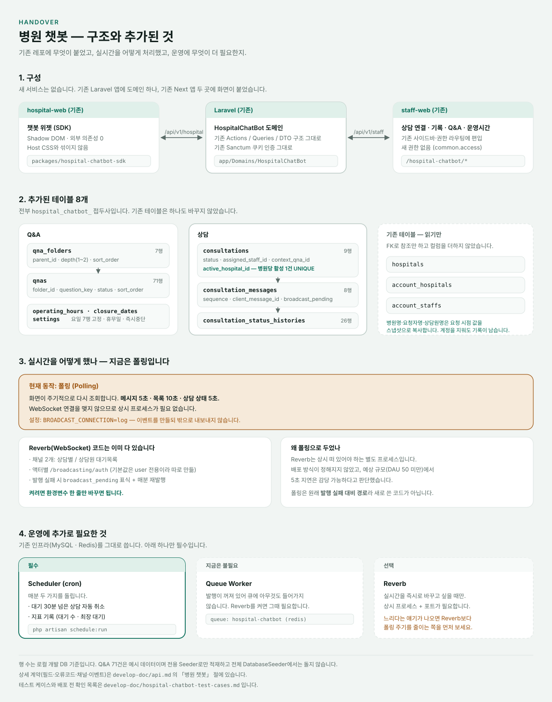
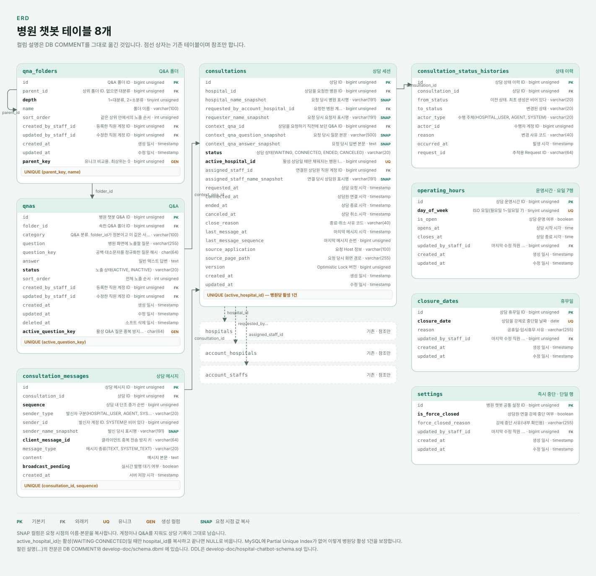

# Hospital Chatbot Handoff

## 사용자 작업 원칙

- PRD, 작업지시서, `AGENTS.md`를 항상 따른다.
- 챗봇 개발 범위만 변경하며 운영/공용 서버 배포, 원격 DB 마이그레이션·시딩, 원격 큐·Reverb 실행은 하지 않는다.
- 모든 기능 브랜치는 `feat/hospital-chatbot` 또는 직전 스택 브랜치에서 시작한다.
- 기능별로 커밋을 나누고, 완료된 PR은 Draft가 아닌 Ready로 생성한다.
- 코드·스키마·설정 PR에는 실제 수행 결과를 포함한 `Test plan`을 작성한다.
- 검증은 변경 범위에 맞게 최소화한다.
- 사용량이 10% 이하로 남으면 이 파일을 갱신하고 핸드오프한다.
- 리뷰 지적을 고치면 그 코멘트 스레드마다 수정 완료 답글을 단다.

## 구조 한눈에

세 줄 요약이다. **기존 테이블은 하나도 바꾸지 않았고**, **실시간은 폴링이며**, **상시 프로세스는 Scheduler 하나만 필요하다.** 왜 그렇게 되어 있는지와 스냅샷·생성 컬럼의 근거는 [구조 문서](develop-doc/architecture.md#병원-챗봇-구조)에 있다. 여기서 반복하지 않는다.

| 찾는 것 | 문서 |
|---|---|
| 구조·테이블·왜 그렇게 했는지 | [architecture.md](develop-doc/architecture.md#병원-챗봇-구조) |
| 컬럼 정의 | [schema.dbml](develop-doc/schema.dbml) 「병원 챗봇」 블록 |
| DDL | [hospital-chatbot-schema.sql](develop-doc/hospital-chatbot-schema.sql) |
| 연동 계약 (필드·오류코드·채널) | [api.md](develop-doc/api.md) 「병원 챗봇」 절 |
| 확인 항목·배포 전 목록 | [hospital-chatbot-test-cases.md](develop-doc/hospital-chatbot-test-cases.md) |
| 요구사항 | [hospital-chatbot-prd.md](develop-doc/hospital-chatbot-prd.md) |

## 현재 상태 (2026-09-28 갱신)

**Phase 2~6이 전부 통합 브랜치 `feat/hospital-chatbot`에 들어갔다.** 기능 티켓은 모두 닫혔고 남은 것은 사람이 브라우저에서 봐야 하는 확인뿐이다.

| Phase | 내용 | PR |
|---|---|---|
| 2 | Q&A·운영시간 관리, SDK Q&A 화면 | BE #84·#87 / FE #29·#30 |
| 3 | 상담 생성·연결·취소·종료, 대기 목록, SDK 대기 화면 | BE #88·#89 / FE #31·#32 |
| 4 | 메시지 저장·조회, 채널·인가, 양쪽 채팅 화면 | BE #90 / FE #33 |
| 5 | 상담 기록 조회·필터, 상태 이력, CSV 내보내기 | BE #94 / FE #41 |
| 6 | 로그·지표, 연동 계약 문서, 테스트 케이스 | BE #95·#96·#97 / FE #42·#43 |
| 그 외 | Q&A 폴더 2단·드래그 정렬, 상담 맥락 전달, SDK 분해 | BE #91·#92·#93 / FE #34~#40 |
| 마무리 | 저장소 관례 정리(`Actions/Common`, 로그 형식, 지표 5분), 이 핸드오버 문서·구조도·ERD·DDL | BE #99 · #98 |
| 클라이언트 요청 | 「상담 연결」·「상담 기록」을 **「상담 관리」** 한 화면(왼쪽 목록 / 오른쪽 대화)으로 통합. 그 과정에서 잡은 SDK 버그 둘. 실시간 문서 정정 | FE #44·#45 / BE #102·#103 |

PRD 17장 티켓 47개 기준 **완료 40 / 진행중 4 / 남음 2 / 보류 1**이다. 현황판은 저장소 밖 `html/chatbot-roadmap.html`에 있다.

자동 테스트는 챗봇 범위에서 **BE 58개 · 관리자 FE 104개 · SDK 47개**가 통과한다.

### 결정된 것

- **화면은 폴링한다(2026-09-27, 09-29 재확정).** 처음엔 "Reverb를 띄우지 않는다"로 이해했는데, Reverb는 기존 채팅·알림용으로 2026-04부터 운영에 떠 있는 것이었다. 그걸 알고도 폴링을 기본으로 두기로 했다. 관리자 화면(staff-web)과 병원 관리자(hospital-web, SDK에 어댑터 주입) 둘 다 Echo 구독 코드가 이미 있어 `NEXT_PUBLIC_REVERB_APP_KEY`가 있으면 구독한다. 로컬은 Reverb를 안 띄워 폴링으로만 돌았다. 백엔드는 발행까지 하고 발행 실패는 경고 로그로 삼킨다. 느리다는 얘기가 나오면 구독보다 **폴링 주기를 줄이는 쪽을 먼저** 본다. 동작 방식은 [구조 문서](develop-doc/architecture.md#병원-챗봇-구조)에 있다.
- **BE-02 Identity Adapter는 보류다.** D-25에 따라 SDK가 같은 오리진에서만 도는 이상 어댑터를 둘 이유가 없다. 지금 만들면 쓰지 않을 추상화만 남는다.

### 브라우저로 확인한 것 (2026-09-28)

상담원·병원 양쪽에 로그인해 Q&A 탐색 → 상담 요청 → 연결 → 양방향 채팅 → 종료 → 기록 조회 → CSV까지 끝까지 돌렸다. 09-29에는 통합된 상담 관리 화면에서 같은 흐름을 다시 돌리고 조건 검색·CSV 잠금·요청 취소까지 봤다. 폴더 드래그 정렬과 기록 화면 뒤로가기 조건 복원도 확인했다. 종료 전파는 0.7초였다.

그 과정에서 결함 하나를 찾아 고쳤다(연결 요청 중 끝내기 버튼이 "취소 중"이라고 하던 것, FE #42).

### 아직 아무도 확인하지 않은 것

자동 테스트가 덮지 못하는 것 중 **6가지**가 남았다. 목록과 재현 방법은 [테스트 케이스 문서](develop-doc/hospital-chatbot-test-cases.md#배포-전-훑을-것-qa-08)의 「배포 전 훑을 것」이 정본이다. 위젯 열고 닫기의 Host 회귀와 CSV를 실제 엑셀로 여는 것은 2026-09-28 사용자가 직접 확인했다.

가장 걸리는 둘만 여기 적는다.

- **동시 요청의 유니크 위반 경로는 자동 테스트도 밟지 않는다.** 순차 연타만 덮는다. 두 탭에서 동시에 요청하는 확인도 아직이다.
- **상담원 둘이 동시에 연결을 누르는 것은 브라우저로 못 봤다.** 상담원 계정이 하나라서다. 자동 테스트는 덮는다.

### 로컬 서버 기동 메모

- 프론트 worktree에는 `.env.local`이 복사되지 않는다(ignored). `beaulab_new_frontend/apps/*/`.env.local`을 worktree의 같은 경로로 복사해야 `NEXT_PUBLIC_API_URL`이 잡힌다.
- staff-web은 `pnpm exec next dev -p 3010`으로 띄운다. 3010을 여러 worktree가 동시에 쓸 수 없으므로 기존 프로세스를 먼저 내린다.
- API는 backend worktree에서 `php artisan serve --port=8000`.
- Sanctum이 `config/sanctum.php`에서 `'guard' => []`이라 **Bearer 토큰이 통하지 않는다**. API 수동 확인은 쿠키 세션이 필요하고, 도메인 레벨 확인은 `bootstrap/app.php`를 로드하는 스크립트에서 Action을 직접 호출하면 된다.
- `closure_dates` 항목의 키는 `date`다(`closure_date` 아님).

## 결정 사항 (2026-09-23 사용자 확정)

### D-25 인증 Adapter — **현행 유지로 확정**

챗봇은 당분간 **이 사이트(hospital-web) 안에서만 돈다**. 따라서 별도 인증 Adapter를 설계하지 않는다.

- 상담 API도 기존 `/api/v1/hospital/hospital-chatbot/*`와 같은 자리에 `Authenticate:sanctum` + `EnsureActor:hospital`로 붙인다.
- 서버가 쿠키 세션에서 병원을 직접 읽으므로 프론트가 보낸 `hospitalId`를 신뢰하지 않는다. PRD 4.3 요구사항은 이걸로 충족된다.
- 같은 오리진이라 Laravel 브로드캐스팅 인가도 기본 세션으로 동작한다. 실시간 채널 인가를 따로 설계할 필요가 없다.
- **단, SDK가 콜백(`loadQnas` 등)을 주입받는 현재 구조는 그대로 유지한다.** 나중에 병원 쪽 사이트로 독립 배포(D-29)할 일이 생겨도 주입 함수만 교체하면 된다. SDK 내부에서 직접 `fetch`를 호출하기 시작하면 그때 전면 수정이 필요해진다.
- 크로스 오리진으로 나갈 때가 오면 그때 단기 토큰 발급 방식을 다시 검토한다. 그 경우 `config/sanctum.php`의 `'guard' => []`를 손봐야 Bearer가 동작한다.

남은 필수 결정 3건(D-14 Export 범위, D-15 보존 기간, D-21 Q&A 중복)은 Phase 5 전까지 미뤄도 된다.

### 남은 결정

D-14(Export 범위), D-15(보존 기간), D-21(Q&A 중복)은 Phase 5를 넘기며 실무 기본값으로 굳었다. Export는 기간 92일·1만 행 상한(설정값), Q&A 중복은 활성 질문 기준 유니크다. 보존 기간은 여전히 정해지지 않았고 지금은 무제한이다.

## 검증 관련 주의

- Backend 테스트용 `beaulab_testing` DB와 권한은 컨테이너 MySQL에 준비됐고, 챗봇 범위 58개가 통과한다. 실행 명령은 `vendor/bin/phpunit`이며 `php artisan test`는 이 저장소에 없다.
- 운영시간 작업에서도 원격/공용 DB에는 절대 마이그레이션하지 않는다.
- Backend 운영시간 worktree에는 `composer install`이 완료되어 `vendor/`가 있다(ignored).

## 로컬 실행 상태

- MySQL 8.4 / Redis 7은 Docker 컨테이너로 실행한다. MySQL은 호스트 3307에 매핑했다(3306은 다른 프로젝트 MariaDB가 점유).
- compose 파일은 저장소 밖 `docker-compose.yml`(저장소 상위 폴더)에 있다. 비밀번호가 들어 있어 커밋하지 않는다.
- 로컬 개발 DB `beaulab_frontend_local`에는 Q&A 71건과 폴더 7개가 적재되어 있다.
- API 8000, hospital-web 3002, staff-web 3010. staff-web은 3000이 다른 프로젝트에 선점되어 3010을 쓰며, 그때는 `.env`의 `STAFF_WEB_ORIGINS`에 해당 Origin을 추가해야 한다.
- macOS 환경 구축 기록은 백엔드 `develop-doc/local-setup-macos.md`에 있다.

## 도구 경로

개발자 PC마다 다르므로 절대경로를 기록하지 않는다. 사용하는 도구는 다음과 같고, 설치 위치는 각자 환경에서 확인한다.

- PHP 8.3 이상과 Composer 2 (macOS 설치 기록은 `develop-doc/local-setup-macos.md`)
- GitHub CLI `gh`
- Node와 pnpm. 프론트 저장소는 `packageManager`에 지정된 pnpm 버전을 사용한다.
