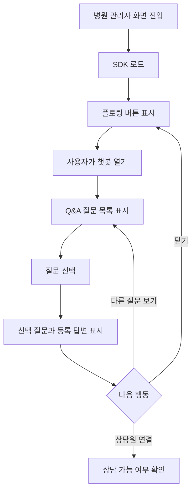
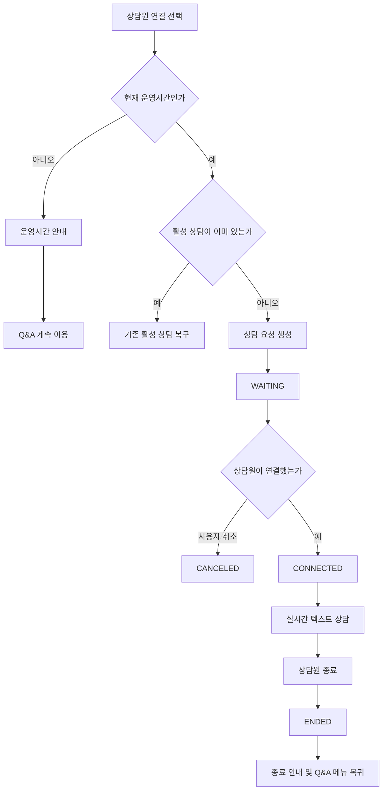
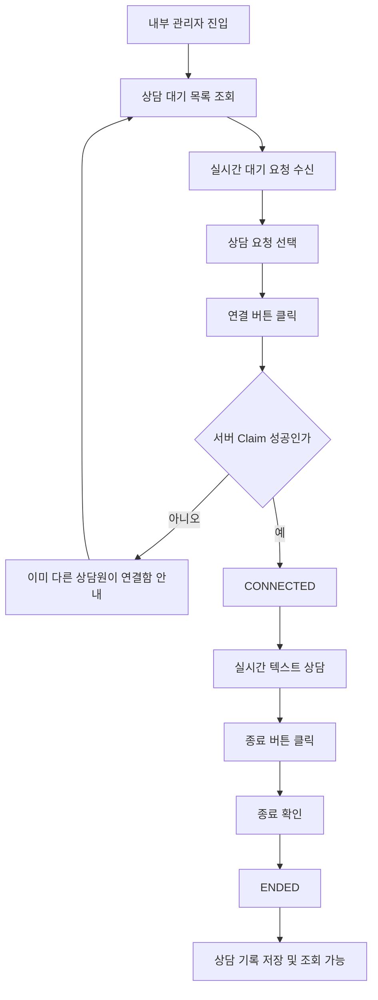
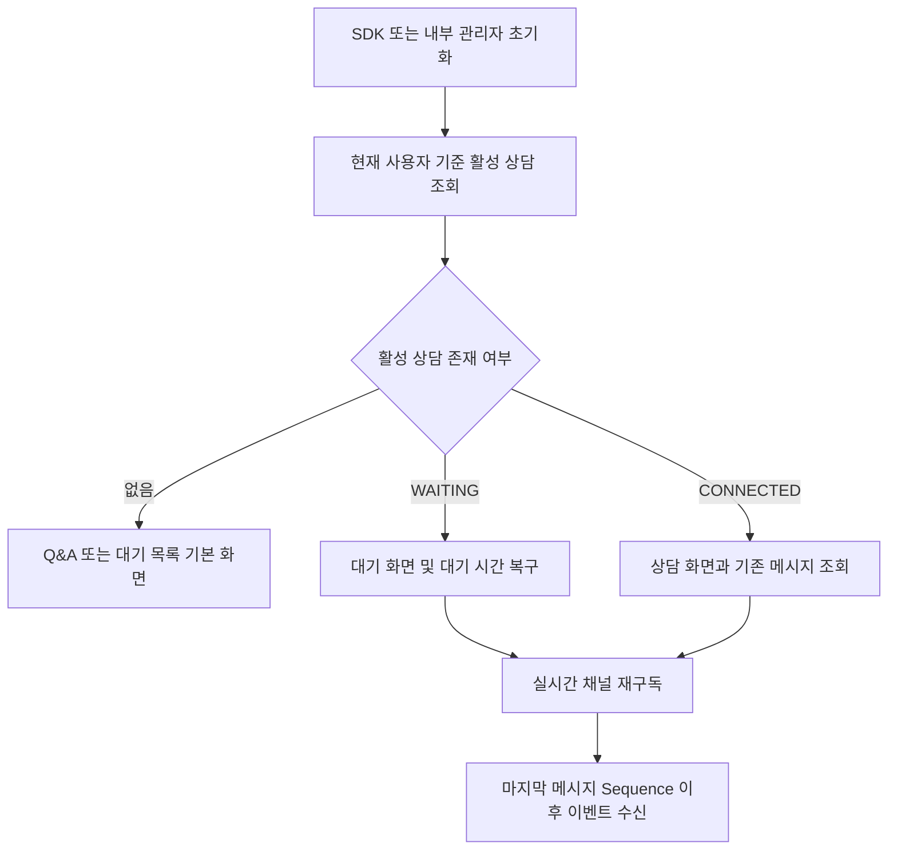
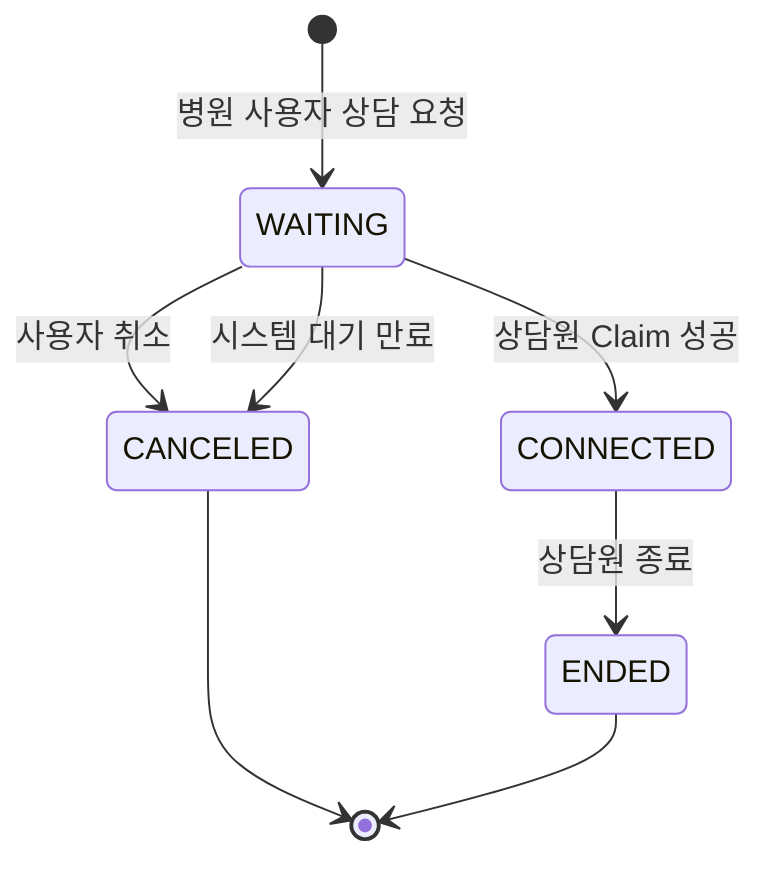
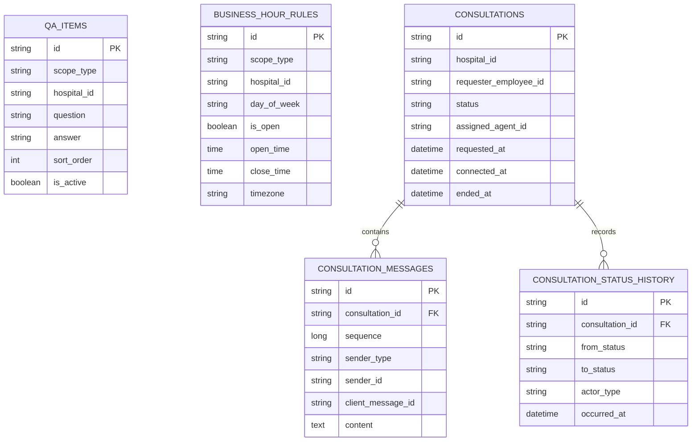

# 병원 관리자 챗봇·상담원 연결 시스템 PRD

> 병원 관리자 화면에 삽입되는 Q&A형 챗봇 SDK와 뷰랩스 내부 관리자용 실시간 상담 관리 기능의 제품 요구사항 문서

| 항목        | 내용                                                                                            |
| ----------- | ----------------------------------------------------------------------------------------------- |
| 문서 버전   | v0.2                                                                                            |
| 문서 상태   | Draft — 2026-09-23 1차 제품 정책 반영, 잔여 미정 사항 확인 필요                                      |
| 기준일      | 2026-09-23                                                                                      |
| 대상 시스템 | 병원 관리자 Frontend SDK / 뷰랩스 내부 관리자 Frontend / Backend                                |
| 구현 원칙   | 기존 레포의 아키텍처, 코딩 규칙, API 규약, 인증 연동 방식, UI 컴포넌트 및 배포 방식을 우선한다. |
| 핵심 전제   | AI 생성 답변 없음, 등록된 Q&A 선택형, 실시간 텍스트 상담, 기존 권한 체계는 별도 연동            |

---

## 0. 확정된 MVP 제품 정책

1. 상담은 병원 단위의 독립 세션이다. 병원당 활성 상담은 한 건이고, 종료·취소 후 다음 요청은 새 세션으로 생성한다.
2. SDK는 Host와 독립적으로 빌드·배포·버전 관리하며, 기존 병원 웹 세션을 인증 Adapter로 재사용한다.
3. Q&A는 전체 병원 공통이고 24시간 이용 가능하다.
4. 운영시간은 `Asia/Seoul` 기준 요일별 단일 구간으로 설정하고, 날짜별 공휴일·임시휴무 강제 OFF를 지원한다. 운영 외에는 상담 요청을 막고 Q&A만 허용한다.
5. 대기 취소는 허용하고, 대기 중 입력은 비활성화하며, 기본 30분 후 자동 만료한다.
6. 상담원은 수동 Claim하고 담당자만 응답·종료한다. 상담원별 동시 상담 수는 제한하지 않는다.
7. 종료 상담은 관리자만 조회하고 병원 화면에는 이력을 제공하지 않는다. `새 채팅 시작`을 제공하고 터미널/Q&A UI는 기본 24시간 미활동 후 초기화하되, 활성 상담은 제외한다.
8. CSV 내보내기는 MVP에 포함한다. 예상 병원 사용자는 DAU 50 미만이며 기존 Laravel·MySQL·Redis·Horizon·Reverb 인프라로 시작한다.

아래 세부 항목의 `권장`·`결정 필요`·`MVP 제외` 표현과 위 정책이 충돌하면 이 섹션을 우선한다.

---

## 목차

1. [문서 목적](#1-문서-목적)
2. [제품 개요](#2-제품-개요)
3. [목표와 성공 조건](#3-목표와-성공-조건)
4. [범위](#4-범위)
5. [사용자와 용어](#5-사용자와-용어)
6. [전제와 구현 제약](#6-전제와-구현-제약)
7. [전체 사용자 흐름](#7-전체-사용자-흐름)
8. [화면별 상세 요구사항](#8-화면별-상세-요구사항)
9. [기능 요구사항](#9-기능-요구사항)
10. [User Story와 Acceptance Criteria](#10-user-story와-acceptance-criteria)
11. [상담 상태 모델과 전이 규칙](#11-상담-상태-모델과-전이-규칙)
12. [예외 케이스와 처리 정책](#12-예외-케이스와-처리-정책)
13. [REST API 초안](#13-rest-api-초안)
14. [DB Entity 초안](#14-db-entity-초안)
15. [WebSocket 이벤트 정의](#15-websocket-이벤트-정의)
16. [비기능 요구사항](#16-비기능-요구사항)
17. [FE/BE 개발 티켓 분해](#17-febe-개발-티켓-분해)
18. [MVP Done 기준](#18-mvp-done-기준)
19. [테스트 시나리오](#19-테스트-시나리오)
20. [결정 필요 사항](#20-결정-필요-사항)
21. [권장 개발 순서](#21-권장-개발-순서)
22. [요구사항 추적표](#22-요구사항-추적표)

---

# 1. 문서 목적

이 문서는 다음 세 시스템의 기능, 상태, 데이터, API 및 개발 범위를 하나의 기준으로 정리한다.

1. 병원 관리자 화면에서 로드되는 챗봇 SDK
2. 뷰랩스 내부 관리자의 상담 및 콘텐츠 관리 화면
3. Q&A, 운영시간, 상담 세션, 메시지 및 실시간 이벤트를 처리하는 Backend

본 문서의 목적은 다음과 같다.

- 기획, 디자인, Frontend, Backend, QA가 동일한 상태 모델과 용어를 사용한다.
- 화면 단위 요구사항을 실제 개발 티켓으로 분리할 수 있게 한다.
- 상담 연결 과정에서 발생하는 동시성, 새로고침, 재접속, 중복 요청 등의 예외를 구현 전에 합의한다.
- 기존 레포와 권한 체계에 연결해야 하는 경계를 명확하게 한다.
- MVP 완료 여부를 객관적으로 판단할 수 있는 기준을 제공한다.

이 문서는 특정 Framework, WebSocket 제품, Message Broker, DB 제품 또는 인증 방식을 확정하지 않는다. 기술 선택은 기존 레포와 운영 환경을 우선한다.

---

# 2. 제품 개요

## 2.1 배경

병원 관리자는 병원 관리자 시스템을 이용하면서 제품 사용 방법이나 기능에 대한 도움을 받아야 한다. 단순 문의는 미리 등록된 Q&A를 통해 즉시 해결하고, Q&A로 해결되지 않는 경우 뷰랩스 내부 상담원과 실시간 텍스트 상담을 진행한다.

내부 상담원은 뷰랩스 관리자 화면에서 상담 요청을 확인하고, 요청을 수락하여 채팅한 뒤 상담을 종료한다. 내부 관리자는 Q&A와 상담 운영시간을 관리하고 과거 상담 기록을 조회하거나 내보낼 수 있다.

## 2.2 제품 구조

```text
병원 관리자 Host Application
        │
        │ SDK 로드 및 사용자 컨텍스트 전달
        ▼
병원 관리자용 Chatbot SDK
        │
        ├── 등록 Q&A 조회
        ├── 상담 가능 여부 확인
        ├── 상담 연결 요청
        ├── 실시간 텍스트 채팅
        └── 상담 종료 상태 수신
        │
        ▼
Backend
        │
        ├── Q&A 저장/조회
        ├── 운영시간 계산
        ├── 상담 상태 전이
        ├── 메시지 영속화
        ├── 실시간 이벤트 전달
        └── 상담 기록/내보내기
        │
        ▼
뷰랩스 내부 관리자
        ├── 상담 대기 목록
        ├── 상담 연결/종료
        ├── 실시간 텍스트 채팅
        ├── 상담 기록 조회/내보내기
        ├── Q&A 관리
        └── 운영시간 관리
```

## 2.3 제품 UX 방향

제공된 UI 시안을 기준으로 다음 방향을 따른다.

- 우측 하단에 플로팅 버튼으로 챗봇을 열고 닫는다.
- 챗봇 상단에는 서비스명과 닫기 버튼이 있는 헤더를 둔다.
- 사용자의 선택 또는 입력은 우측 말풍선, 챗봇·시스템·상담원 응답은 좌측 말풍선으로 표현한다.
- Q&A 답변 아래에 `다른 질문 보기`, `상담원 연결`과 같은 빠른 액션을 제공한다.
- 상담 대기, 상담 연결, 상담 종료 상태를 시스템 메시지와 하단 상태 문구로 명확하게 표시한다.
- 상담 연결 후에만 텍스트 입력을 활성화하는 것을 MVP 권장안으로 한다.
- 상담이 종료되면 입력을 비활성화하고 Q&A 질문 메뉴로 돌아갈 수 있게 한다.

---

# 3. 목표와 성공 조건

## 3.1 제품 목표

- 병원 관리자가 등록된 Q&A를 통해 자주 묻는 질문의 답을 빠르게 찾을 수 있다.
- 해결되지 않은 문의를 운영시간 내 상담원에게 전달할 수 있다.
- 상담원은 요청을 실시간으로 확인하고 중복 배정 없이 상담을 시작할 수 있다.
- 양측의 메시지와 상담 상태가 저장되어 새로고침 및 재접속 후 복구된다.
- 관리자는 Q&A, 상담 운영시간 및 상담 이력을 관리할 수 있다.

## 3.2 MVP 성공 조건

MVP는 다음 조건을 모두 충족해야 한다.

1. 병원 관리자 실제 화면에서 SDK가 정상적으로 로드된다.
2. 등록된 Q&A 질문과 답변을 조회할 수 있다.
3. 운영시간 내 상담 요청이 내부 관리자 대기 목록에 표시된다.
4. 동일 요청은 한 명의 상담원만 연결할 수 있다.
5. 연결 후 병원 사용자와 상담원이 실시간 텍스트 메시지를 주고받을 수 있다.
6. 새로고침 또는 일시적 네트워크 단절 후 활성 상담과 메시지를 복구할 수 있다.
7. 상담원이 종료하면 양측 상태가 종료로 일치한다.
8. 상담 종료 후 병원 사용자에게 Q&A 질문 선택 UI가 다시 제공된다.
9. 상담 기록과 메시지가 내부 관리자에서 조회된다.
10. 조건에 맞는 상담 기록을 CSV 등 확정된 형식으로 내보낼 수 있다.
11. Q&A 등록·수정·삭제와 운영시간 설정이 관리자 화면에서 가능하다.
12. 실제 배포 대상 환경에서 요청부터 종료까지 E2E 테스트가 통과한다.

---

# 4. 범위

## 4.1 In Scope

### 병원 관리자 Frontend / SDK

- 기존 병원 관리자 화면에서 SDK 비동기 로드
- 챗봇 플로팅 버튼 및 채팅창 표시
- 등록된 Q&A 질문 목록 조회
- 질문 선택 및 등록된 답변 표시
- 다른 질문 보기
- 상담원 연결 가능 여부 확인
- 상담원 연결 요청
- 상담 대기 상태 표시
- 상담 대기 취소 기능 — 권장 기본안
- 상담원 연결 상태 표시
- 실시간 텍스트 메시지 송수신
- 메시지 전송 중·성공·실패 상태 표시
- 상담 종료 상태 수신
- 상담 종료 후 Q&A 메뉴 재진입
- 새로고침, 위젯 닫기/재열기, 네트워크 재연결 시 상태 복구

### 뷰랩스 내부 관리자 Frontend

- 상담 대기 목록
- 상담 진행 목록 또는 진행 중 상태 필터
- 상담 연결 버튼
- 상담 종료 버튼
- 실시간 텍스트 채팅
- 상담 요청 및 상태의 실시간 갱신
- 과거 상담 기록 목록 조회
- 상담 기록 상세 및 메시지 조회
- 상담 기록 필터 및 내보내기
- Q&A 목록/등록/수정/삭제
- Q&A 노출 순서 및 활성 여부 관리
- 요일별 상담 운영시간 관리

### Backend

- 기존 시스템에서 전달받은 병원 및 직원 식별값 저장
- Q&A 저장 및 조회
- 운영시간 저장 및 상담 가능 여부 계산
- 상담 세션 생성, 연결, 취소, 종료
- 상담 상태 전이 검증
- 상담원 연결 시 동시성 제어
- 메시지 저장 및 순서 보장
- 실시간 이벤트 발행
- 상담 및 메시지 기록 조회
- 상담 기록 내보내기
- 중복 요청 및 중복 메시지 방지
- 주요 작업 감사 로그 또는 상태 이력 저장

## 4.2 Out of Scope

다음 항목은 MVP에 포함하지 않는다.

- AI가 생성하는 답변
- 자연어 질문의 의미 분석 또는 자동 Q&A 추천
- 외부 LLM 연동
- 이미지, 동영상, 음성, 파일 첨부
- 음성 또는 영상 상담
- 읽음 표시
- 상대방 입력 중 표시
- 상담원 자동 배정
- 상담원 간 이관
- 상담원 그룹, 스킬 기반 라우팅
- 이메일, SMS, 모바일 Push 알림
- 상담 만족도 평가
- 상세 통계 또는 BI 대시보드
- 다국어
- 공휴일 캘린더 자동 연동
- 복수 휴게시간 또는 복수 영업 구간 — 예: 09:00~~12:00, 13:00~~18:00
- 환자 진료 상담 또는 의료적 판단
- 신규 인증/권한 시스템 개발

## 4.3 인증·권한 Integration Boundary

상대측이 기존 권한 체계에 추후 연결하기로 했으므로, 본 프로젝트에서는 신규 권한 모델을 설계하거나 구현하지 않는다. 다만 아래의 연동 경계는 반드시 제공한다.

- SDK 초기화 시 Host가 병원과 직원 식별에 필요한 컨텍스트를 전달할 수 있어야 한다.
- Backend는 최종 연동 시 기존 인증 계층에서 검증된 병원/직원/내부 관리자 식별 정보를 받을 수 있어야 한다.
- Frontend가 임의로 전달한 `hospitalId`, `employeeId`, `agentId`만으로 운영 데이터 접근을 허용하지 않는 구조로 연결 가능해야 한다.
- 개발 환경에서는 Mock Identity 또는 테스트 계정을 사용할 수 있다.
- API 인터페이스에서 인증 토큰 형식이나 Header 이름은 기존 레포 규칙 확정 후 반영한다.
- 권한별 메뉴 노출과 API 접근 제어의 실제 정책은 기존 권한 체계 담당 범위이다.

---

# 5. 사용자와 용어

## 5.1 사용자

| 사용자           | 설명                                      | 주요 행동                                  |
| ---------------- | ----------------------------------------- | ------------------------------------------ |
| 병원 사용자      | 병원 관리자 시스템을 사용하는 병원 직원   | Q&A 조회, 상담 요청, 상담원과 채팅         |
| 내부 상담원      | 상담 요청에 응답하는 뷰랩스 직원          | 대기 요청 확인, 연결, 채팅, 종료           |
| 내부 관리자      | 콘텐츠와 운영 정책을 관리하는 뷰랩스 직원 | Q&A/운영시간 관리, 상담 기록 조회/내보내기 |
| Host Application | SDK를 삽입하는 기존 병원 관리자 시스템    | SDK 로드, 사용자 컨텍스트 전달             |

내부 상담원과 내부 관리자는 기존 권한 체계에서 동일 인물일 수 있으며, 실제 메뉴 접근 범위는 기존 시스템 정책에 따른다.

## 5.2 용어

| 용어      | 정의                                                               |
| --------- | ------------------------------------------------------------------ |
| SDK       | 병원 관리자 화면에 삽입되어 챗봇 UI와 Backend 통신을 담당하는 모듈 |
| Q&A       | 내부 관리자가 미리 등록한 질문과 답변 쌍                           |
| 상담 요청 | 병원 사용자가 상담원 연결을 요청하여 생성되는 상담 세션            |
| 상담 세션 | 한 번의 요청부터 취소 또는 종료까지의 단위                         |
| 대기 상태 | 상담원 연결 요청은 생성되었지만 상담원이 아직 연결하지 않은 상태   |
| 연결 상태 | 특정 상담원이 요청을 수락하여 실시간 상담이 가능한 상태            |
| 종료 상태 | 상담원이 상담 종료를 확정한 상태                                   |
| 취소 상태 | 상담원 연결 전에 사용자 또는 시스템 정책에 의해 요청이 철회된 상태 |
| 활성 상담 | `WAITING` 또는 `CONNECTED` 상태인 상담                             |
| 상담 기록 | 종료·취소된 상담 세션과 그 메시지 및 상태 이력                     |
| 운영시간  | 상담원 연결 요청이 허용되는 요일 및 시간                           |
| Q&A 모드  | 질문 선택형 Q&A를 이용하는 상태                                    |
| 상담 모드 | `WAITING` 또는 `CONNECTED` 상담을 표시하는 상태                    |

---

# 6. 전제와 구현 제약

1. Q&A는 생성형 AI가 아니라 내부 관리자가 등록한 정적 데이터이다.
2. 상담 메시지는 MVP에서 일반 텍스트만 지원한다.
3. 내부 관리자 구현은 기존 PHP 관리자 환경을 포함한 기존 레포 구조와 규칙을 우선한다. 실제 기술 스택은 레포 확인 후 확정한다.
4. 실시간 통신 기술은 기존 레포에 존재하는 방식이 있으면 재사용한다.
5. 서버 DB에 저장된 상담과 메시지를 최종 상태의 기준으로 삼는다.
6. WebSocket 이벤트는 화면 갱신 수단이며, 유실 시 REST 재조회로 복구 가능해야 한다.
7. 날짜와 시각은 서버에서 ISO 8601 형식으로 전달하며, 저장은 UTC를 권장한다.
8. 화면 표시 시간대는 MVP 기본안으로 `Asia/Seoul`을 사용한다.
9. 챗봇 Q&A는 24시간 이용 가능하고, 운영시간은 상담원 연결 가능 여부에만 적용하는 것을 권장한다.
10. 위젯을 닫는 행위와 상담을 취소하거나 종료하는 행위는 다르다.
11. 한 병원 사용자는 동시에 하나의 활성 상담만 보유하는 것을 권장한다.
12. 상담원 연결은 서버에서 원자적으로 처리되어야 한다.
13. 메시지는 DB 저장 성공 후 상대방에게 실시간 이벤트로 전달되어야 한다.
14. 삭제된 Q&A와 과거 상담 메시지는 감사 및 이력 목적상 물리 삭제보다 Soft Delete 또는 비활성화를 우선한다.

---

# 7. 전체 사용자 흐름

## 7.1 Q&A 기본 흐름



## 7.2 상담 연결 흐름



## 7.3 내부 상담원 흐름



## 7.4 새로고침·재접속 복구 흐름



---

# 8. 화면별 상세 요구사항

# 8.1 병원 관리자 SDK

## SDK-S01. 플로팅 런처 및 채팅창 Shell

### 목적

병원 관리자 화면의 기존 기능을 방해하지 않으면서 챗봇을 열고 닫을 수 있게 한다.

### 주요 UI

- 화면 우측 하단 원형 플로팅 버튼
- 챗봇 열림 상태에서 닫기 아이콘
- 상단 Gradient Header
- 서비스 아이콘과 `뷰랩스 챗봇` 명칭
- 상단 닫기 버튼
- 스크롤 가능한 대화 영역
- 하단 상태/입력 영역

### 동작

- SDK는 Host 화면의 초기 렌더링을 Blocking하지 않도록 비동기 로드한다.
- 런처 클릭 시 채팅창을 연다.
- Header 닫기 또는 런처 닫기 클릭 시 채팅창만 닫는다.
- 채팅창을 닫아도 `WAITING` 또는 `CONNECTED` 상담은 유지된다.
- 다시 열면 마지막 활성 상태와 메시지를 복구한다.
- 모바일·작은 화면에서는 채팅창이 화면을 넘지 않아야 한다.
- Host CSS와 충돌하지 않도록 Style Scope 또는 기존 레포의 격리 방식을 따른다.

### 표시 상태

- Loading
- Ready
- Open
- Closed
- Recovering
- Fatal Error

---

## SDK-S02. Q&A 질문 선택 화면

### 목적

병원 사용자가 자유 입력 없이 등록된 질문 중 하나를 선택하여 답변을 확인하게 한다.

### 주요 UI

- 안내 문구 또는 인사 메시지
- 활성 Q&A 질문 버튼 목록
- 운영시간과 무관하게 사용할 수 있다는 안내 — 확정 문구는 디자인/기획 결정
- Q&A가 없을 때 Empty State

### 동작

- 활성 상태이며 삭제되지 않은 Q&A만 표시한다.
- `sortOrder` 오름차순으로 표시하고 동일 값이면 생성순 또는 ID순으로 정렬한다.
- 질문 버튼을 선택하면 선택한 질문을 사용자 말풍선으로 표시하고 답변을 이어서 표시한다.
- 질문 목록 조회에 실패하면 재시도 UI를 제공한다.
- 질문 수가 많을 경우 대화 영역 내부에서 스크롤한다.
- MVP에서는 자유 텍스트 질문 입력란을 제공하지 않는다.

### Empty State 권장 문구

- `현재 등록된 질문이 없습니다.`
- 운영시간 내라면 `상담원 연결`을 함께 제공할 수 있다.

---

## SDK-S03. Q&A 답변 화면

### 주요 UI

- 사용자가 선택한 질문 말풍선
- 등록된 답변 말풍선
- `다른 질문 보기` 버튼
- `상담원 연결` 버튼

### 동작

- Q&A 답변은 Text로 렌더링하고 HTML을 직접 실행하지 않는다.
- 줄바꿈은 보존하되 Script, Event Handler 등의 실행은 차단한다.
- `다른 질문 보기` 선택 시 질문 목록을 다시 표시한다.
- 기존 대화를 유지할지 새 화면으로 전환할지는 UI 구현 방식에 따르되, 현재 질문과 답변이 혼동되지 않아야 한다.
- `상담원 연결` 선택 시 서버 기준 상담 가능 여부를 확인한다.

---

## SDK-S04. 운영시간 외 안내 화면

### 목적

운영시간 외에는 상담 요청을 생성하지 않고 사용 가능한 시간을 안내한다.

### 주요 UI

- 현재 상담원 연결이 불가능하다는 메시지
- 다음 상담 가능 시간 또는 요일별 운영시간
- `다른 질문 보기` 버튼
- 채팅창 닫기 버튼

### 동작

- 운영시간 판정은 브라우저 시간이 아니라 Backend 결과를 사용한다.
- 운영시간 종료 시각과 정확히 같은 시각은 운영 종료로 처리하는 것을 권장한다.
- 운영시간 설정이 없거나 잘못된 경우 Fail Closed 정책으로 상담 요청을 막고 안내 메시지를 표시한다.
- Q&A 이용은 계속 가능하다.

---

## SDK-S05. 상담 대기 화면

### 주요 UI

- `상담원을 연결하고 있습니다. 잠시만 기다려 주세요.` 시스템 메시지
- `상담 요청이 접수되었습니다.` 시스템 메시지
- 상담 요청 시각 또는 대기 시간
- 하단 상태 문구 `상담원 연결 대기 중`
- 입력창은 표시하되 비활성화하는 것을 권장
- `상담 요청 취소` 액션 — 권장 기본안

### 동작

- 상담 요청 생성 성공 후 상태를 `WAITING`으로 표시한다.
- 중복 클릭으로 요청이 여러 건 생성되지 않아야 한다.
- 활성 상담이 이미 있으면 신규 생성 대신 기존 상담을 복구한다.
- 상담원이 연결하면 별도 새로고침 없이 `CONNECTED`로 전환한다.
- 사용자가 대기 취소를 선택하면 확인 후 `CANCELED`로 전환한다.
- 위젯 닫기와 상담 취소는 분리한다.
- 새로고침 후에도 대기 상태와 대기 시작 시각을 복구한다.

---

## SDK-S06. 실시간 상담 화면

### 주요 UI

- `상담원이 연결되었습니다.` 시스템 메시지
- 상담원 메시지 좌측 말풍선
- 병원 사용자 메시지 우측 말풍선
- 텍스트 입력창
- 전송 버튼
- 하단 상태 문구 `상담원 상담 중`
- 메시지 전송 실패 시 재시도 UI

### 동작

- 상태가 `CONNECTED`일 때만 메시지 입력과 전송을 허용한다.
- 공백만 있는 메시지는 전송하지 않는다.
- 메시지 최대 길이는 기본안으로 2,000자이다.
- `Enter`는 전송, `Shift + Enter`는 줄바꿈으로 처리하는 것을 권장한다.
- 메시지 전송 요청에는 `clientMessageId`를 포함한다.
- 사용자가 네트워크 문제로 재시도해도 동일 메시지가 중복 저장되지 않아야 한다.
- 메시지는 서버 저장 완료 후 성공 상태로 표시한다.
- 새 메시지 수신 시 사용자가 최신 영역을 보고 있으면 자동 스크롤한다.
- 사용자가 과거 메시지를 보고 있으면 무조건 이동시키지 않고 새 메시지 표시를 제공한다.
- 연결 중 일시적으로 실시간 채널이 끊어져도 입력 내용을 보존하고 재연결 상태를 표시한다.
- 재연결 후 누락 메시지를 REST 조회로 동기화한다.

---

## SDK-S07. 상담 종료 화면

### 주요 UI

- `상담이 종료되었습니다.` 시스템 메시지
- 메시지 입력 비활성화
- `다른 질문 보기` 또는 `질문 메뉴로 돌아가기`
- `닫기`

### 동작

- 상담원이 종료하면 실시간으로 `ENDED` 상태를 반영한다.
- 종료 이후 메시지를 전송할 수 없다.
- 진행 중 전송 요청과 종료가 경합하면 서버에서 먼저 확정된 상태를 기준으로 한다.
- 사용자가 종료 내용을 확인한 후 Q&A 메뉴로 돌아갈 수 있다.
- Q&A 메뉴로 돌아가도 종료된 상담 기록은 삭제되지 않는다.
- 종료된 상담을 재연결할 수 없고, 새 상담 요청은 별도 세션으로 생성한다.

---

## SDK-S08. 복구 및 오류 화면

### 복구 대상

- 페이지 새로고침
- SDK Unmount 후 재Mount
- 위젯 닫기 후 재열기
- 네트워크 단절 후 복구
- WebSocket 재연결
- 다중 탭

### 동작

- 초기화 시 활성 상담을 조회한다.
- 활성 상담이 `WAITING`이면 대기 화면을 복구한다.
- 활성 상담이 `CONNECTED`이면 메시지 목록을 조회하고 상담 화면을 복구한다.
- 마지막 수신 `sequence` 이후 메시지만 추가 조회할 수 있어야 한다.
- 복구 중에는 중복 전송을 방지한다.
- 치명적 오류 시 Q&A 재조회 또는 SDK 재초기화 버튼을 제공한다.

---

# 8.2 뷰랩스 내부 관리자

## ADM-S01. 상담 대기/진행 목록

### 목적

상담원이 신규 요청과 자신이 진행 중인 상담을 한 화면 또는 명확히 구분된 탭에서 확인한다.

### 권장 탭

- 대기 중
- 상담 중
- 전체 또는 최근 종료 — 상담 기록 화면과 분리 가능

### 대기 목록 표시 항목

- 상담 ID 또는 축약 ID
- 병원명/병원 식별값
- 요청자명/직원 식별값
- 요청 시각
- 현재 대기 시간
- 마지막 시스템 상태
- 연결 버튼

### 진행 목록 표시 항목

- 병원명
- 요청자명
- 연결 시각
- 마지막 메시지 시각
- 읽지 않은 새 메시지 표시 — 읽음 기능 자체는 Out of Scope이므로 화면 내 단순 배지로만 구현 가능
- 상담 열기

### 동작

- 화면 진입 시 REST로 Snapshot을 조회한다.
- 이후 신규 요청, 연결, 취소, 종료를 실시간 이벤트로 반영한다.
- 동일 이벤트가 중복 수신되어도 목록에 중복 행이 생기지 않아야 한다.
- 브라우저 Background 복귀 시 목록을 재동기화한다.
- 서버와 상태가 불일치하면 서버 상태를 우선한다.
- 대기 시간은 서버의 `requestedAt`을 기준으로 계산한다.

---

## ADM-S02. 상담 연결

### 주요 UI

- 상담 요청 요약
- `상담 연결` 버튼
- 처리 중 상태
- 이미 다른 상담원이 연결한 경우 안내

### 동작

- 상담원은 `WAITING` 상태 요청만 연결할 수 있다.
- 연결 버튼 클릭 시 서버에서 원자적으로 Claim한다.
- 먼저 성공한 상담원만 `CONNECTED` 응답을 받는다.
- 뒤늦은 요청은 `409 CONSULTATION_ALREADY_CLAIMED` 등의 오류를 받고 목록을 갱신한다.
- 연결 성공 시 상담 상세 화면으로 이동한다.
- 동일 상담원이 빠르게 두 번 클릭해도 한 번만 처리한다.

---

## ADM-S03. 실시간 상담 상세

### 주요 UI

- 병원명, 요청자명, 상담 ID
- 요청/연결 시각
- 상담 상태
- 대화 메시지 목록
- 텍스트 입력창 및 전송 버튼
- `상담 종료` 버튼

### 동작

- 자신이 연결한 상담만 입력 활성화하는 것을 기본안으로 한다.
- 메시지 정렬은 서버 `sequence` 기준이다.
- 상담원의 메시지에도 `clientMessageId`를 사용한다.
- 전송 실패 시 재시도할 수 있다.
- 새로고침 후 상담 세션과 메시지를 복구한다.
- 네트워크 재연결 중에는 상태 배너를 표시한다.
- 상담이 이미 종료된 경우 입력을 비활성화하고 기록 모드로 표시한다.

---

## ADM-S04. 상담 종료

### 동작

- 상담원은 `CONNECTED` 상담에서 종료 버튼을 사용할 수 있다.
- 종료 클릭 시 확인 Modal을 표시한다.
- 종료 사유는 MVP에서 선택값 없이 기본 사유를 저장하거나, 간단한 선택값을 둘 수 있다.
- 서버 성공 응답 전에는 화면을 종료 상태로 확정하지 않는다.
- 종료 성공 후 양측에 `consultation.ended` 이벤트를 전달한다.
- 종료 후 입력창을 비활성화한다.
- 종료 동작은 중복 호출되어도 최종 결과가 동일한 Idempotent 동작이어야 한다.

---

## ADM-S05. 상담 기록 목록

### 표시 항목

- 상담 ID
- 병원
- 요청자
- 담당 상담원
- 요청 시각
- 연결 시각
- 종료/취소 시각
- 대기 시간
- 상담 시간
- 최종 상태
- 종료 사유

### 필터

- 기간
- 병원
- 요청자 식별값
- 상담원
- 상태
- 상담 ID

### 동작

- 기본 기간은 기존 관리자 정책에 따른다. 권장안은 최근 7일 또는 30일이다.
- Cursor 또는 기존 레포의 Pagination 방식을 사용한다.
- 정렬은 기본적으로 최신 요청 시각 내림차순이다.
- 목록 조건을 유지한 채 상세로 이동했다가 돌아올 수 있어야 한다.

---

## ADM-S06. 상담 기록 상세 및 내보내기

### 상세 화면

- 상담 메타데이터
- 상태 변경 이력
- 전체 메시지
- 발신자 유형
- 메시지 시각
- 종료 사유

### 내보내기

- 목록의 현재 필터 조건을 기준으로 내보낸다.
- MVP 권장 형식은 CSV이다.
- 한국어가 깨지지 않도록 UTF-8 BOM 또는 기존 표준을 적용한다.
- 대용량 Export 기준은 별도 결정한다.
- 동기 Export 한도를 넘으면 비동기 Job 방식이 필요하지만 MVP에서는 제한된 기간/건수로 동기 처리할 수 있다.

---

## ADM-S07. Q&A 관리

### 목록

- 질문
- 답변 요약
- 노출 순서
- 활성 여부
- 수정일
- 수정자
- 수정/삭제 액션

### 등록/수정 필드

- 질문 — 필수, 권장 최대 300자
- 답변 — 필수, 권장 최대 10,000자
- 노출 순서 — 정수
- 활성 여부
- Scope — MVP 정책 확정 필요

### 동작

- 등록, 수정, 삭제 후 목록을 갱신한다.
- 삭제는 Soft Delete를 권장한다.
- 삭제된 Q&A는 SDK 신규 조회에서 제외한다.
- 이미 SDK에 표시된 답변은 새로 조회하기 전까지 유지될 수 있다.
- 동일 질문 중복 허용 여부는 결정 필요이며, 기본안은 경고만 표시하고 저장은 허용하지 않는 것이다.
- HTML 입력은 허용하지 않거나 저장 전 Sanitizing한다.

---

## ADM-S08. 상담 운영시간 관리

### 필드

- 적용 Scope — MVP는 전체 병원 공통
- 기준 Timezone — `Asia/Seoul` 고정
- 요일
- 휴무 여부
- 시작 시각
- 종료 시각

### MVP 정책

- 요일별 한 개의 연속 시간 구간을 지원한다.
- 시작 시각은 종료 시각보다 빨라야 한다.
- 자정을 넘기는 시간 구간은 MVP에서 지원하지 않는 것을 권장한다.
- 날짜별 공휴일·임시 휴무 예외를 MVP에 포함하며 해당 날짜는 요일 설정과 무관하게 강제 OFF 처리한다.

### 동작

- 저장 전에 요일별 유효성을 검증한다.
- 운영시간 변경은 저장 이후 새로 들어오는 상담 요청부터 적용한다.
- 이미 생성된 `WAITING` 또는 `CONNECTED` 상담은 운영시간이 변경되어도 유지한다.
- 설정이 없으면 상담 연결은 불가능한 것으로 처리한다.

---

# 9. 기능 요구사항

## 9.1 병원 관리자 SDK 요구사항

| ID         | 요구사항                                                                                   |
| ---------- | ------------------------------------------------------------------------------------------ |
| SDK-FR-001 | Host Application은 SDK를 비동기로 로드할 수 있어야 한다.                                   |
| SDK-FR-002 | SDK는 초기화 시 Host로부터 사용자 컨텍스트 또는 기존 인증 연동 정보를 받을 수 있어야 한다. |
| SDK-FR-003 | 사용자는 플로팅 버튼으로 챗봇을 열고 닫을 수 있어야 한다.                                  |
| SDK-FR-004 | 위젯을 닫아도 활성 상담은 종료되지 않아야 한다.                                            |
| SDK-FR-005 | SDK는 활성 Q&A 목록을 정렬 순서대로 표시해야 한다.                                         |
| SDK-FR-006 | 질문을 선택하면 등록된 답변을 표시해야 한다.                                               |
| SDK-FR-007 | 사용자는 답변 화면에서 다른 질문을 선택할 수 있어야 한다.                                  |
| SDK-FR-008 | 사용자는 답변 화면에서 상담원 연결을 요청할 수 있어야 한다.                                |
| SDK-FR-009 | 상담 가능 여부는 Backend의 서버 시간 기준 결과를 사용해야 한다.                            |
| SDK-FR-010 | 운영시간 외에는 기본안상 상담 요청을 생성하지 않아야 한다.                                 |
| SDK-FR-011 | 상담 요청 성공 시 `WAITING` 상태와 안내 메시지를 표시해야 한다.                            |
| SDK-FR-012 | 동일 사용자의 중복 상담 요청을 방지해야 한다.                                              |
| SDK-FR-013 | 사용자는 연결 전 대기 요청을 취소할 수 있어야 한다 — 권장안.                               |
| SDK-FR-014 | 상담원이 연결하면 화면이 `CONNECTED` 상태로 전환되어야 한다.                               |
| SDK-FR-015 | `CONNECTED` 상태에서만 텍스트 메시지를 전송할 수 있어야 한다.                              |
| SDK-FR-016 | 메시지 전송은 중복 방지를 위한 `clientMessageId`를 사용해야 한다.                          |
| SDK-FR-017 | 실시간으로 상대방 메시지와 상담 상태 이벤트를 수신해야 한다.                               |
| SDK-FR-018 | 새로고침 및 재접속 후 활성 상담과 메시지를 복구해야 한다.                                  |
| SDK-FR-019 | 상담 종료 후 입력을 비활성화해야 한다.                                                     |
| SDK-FR-020 | 상담 종료 후 Q&A 질문 메뉴로 돌아갈 수 있어야 한다.                                        |

## 9.2 내부 관리자 요구사항

| ID         | 요구사항                                                               |
| ---------- | ---------------------------------------------------------------------- |
| ADM-FR-001 | 상담원은 대기 상담 목록을 조회할 수 있어야 한다.                       |
| ADM-FR-002 | 신규 대기 요청과 상태 변경이 실시간으로 목록에 반영되어야 한다.        |
| ADM-FR-003 | 상담원은 `WAITING` 상담을 연결할 수 있어야 한다.                       |
| ADM-FR-004 | 하나의 요청은 한 명의 상담원만 성공적으로 연결할 수 있어야 한다.       |
| ADM-FR-005 | 연결된 상담원은 해당 상담에서 텍스트 메시지를 송수신할 수 있어야 한다. |
| ADM-FR-006 | 상담원은 연결된 상담을 종료할 수 있어야 한다.                          |
| ADM-FR-007 | 새로고침 후 자신이 진행 중인 상담을 복구할 수 있어야 한다.             |
| ADM-FR-008 | 관리자는 상담 기록 목록을 조회하고 필터링할 수 있어야 한다.            |
| ADM-FR-009 | 관리자는 상담 기록 상세에서 전체 메시지를 조회할 수 있어야 한다.       |
| ADM-FR-010 | 관리자는 필터 조건에 맞는 상담 기록을 내보낼 수 있어야 한다.           |
| ADM-FR-011 | 관리자는 Q&A를 등록, 수정, 삭제, 활성/비활성화할 수 있어야 한다.       |
| ADM-FR-012 | 관리자는 Q&A 노출 순서를 관리할 수 있어야 한다.                        |
| ADM-FR-013 | 관리자는 요일별 상담 운영시간을 설정할 수 있어야 한다.                 |
| ADM-FR-014 | 관리자 화면의 API와 UI는 기존 권한 체계와 연결 가능한 구조여야 한다.   |

## 9.3 Backend 요구사항

| ID        | 요구사항                                                                   |
| --------- | -------------------------------------------------------------------------- |
| BE-FR-001 | 병원과 직원의 외부 식별값을 상담 세션에 연결해 저장해야 한다.              |
| BE-FR-002 | 활성 Q&A를 정렬된 형태로 조회할 수 있어야 한다.                            |
| BE-FR-003 | 운영시간을 저장하고 특정 시점의 상담 가능 여부를 계산해야 한다.            |
| BE-FR-004 | 상담 요청 생성 시 중복 활성 상담을 방지해야 한다.                          |
| BE-FR-005 | 상담 상태 전이는 정의된 상태머신을 따라야 한다.                            |
| BE-FR-006 | 상담 연결은 DB Transaction 또는 이에 준하는 원자적 방식으로 처리해야 한다. |
| BE-FR-007 | 메시지는 영속 저장 후 실시간 이벤트를 발행해야 한다.                       |
| BE-FR-008 | 상담별 메시지 순서를 안정적으로 제공해야 한다.                             |
| BE-FR-009 | 중복 `clientMessageId` 요청은 동일 결과를 반환해야 한다.                   |
| BE-FR-010 | 새로고침 복구를 위한 활성 상담 및 메시지 조회 API를 제공해야 한다.         |
| BE-FR-011 | 상담 상태 변경 이력을 조회 가능하게 보존해야 한다.                         |
| BE-FR-012 | 상담 기록 필터, 상세 조회 및 내보내기를 제공해야 한다.                     |
| BE-FR-013 | 실시간 이벤트 유실 시 REST 재동기화가 가능해야 한다.                       |
| BE-FR-014 | 주요 오류와 상태 전이를 추적할 수 있는 로그를 남겨야 한다.                 |

---

# 10. User Story와 Acceptance Criteria

## US-SDK-01. 챗봇 열기와 닫기

**User Story**  
병원 사용자로서, 현재 작업을 방해받지 않고 필요할 때 챗봇을 열고 닫고 싶다.

**Acceptance Criteria**

- **Given** 병원 관리자 화면에 SDK가 정상 로드되었고  
  **When** 사용자가 플로팅 버튼을 누르면  
  **Then** 챗봇 창이 표시된다.

- **Given** 활성 상담이 없는 챗봇 창이 열려 있고  
  **When** 사용자가 닫기 버튼을 누르면  
  **Then** 창만 닫히고 Host 화면은 그대로 유지된다.

- **Given** `WAITING` 또는 `CONNECTED` 상담이 있고  
  **When** 사용자가 챗봇 창을 닫았다 다시 열면  
  **Then** 동일 상담 상태와 메시지가 복구된다.

---

## US-SDK-02. Q&A 조회

**User Story**  
병원 사용자로서, 자주 묻는 질문 중 하나를 선택하여 즉시 답변을 확인하고 싶다.

**Acceptance Criteria**

- **Given** 활성 Q&A가 등록되어 있고  
  **When** 사용자가 챗봇을 열면  
  **Then** 질문이 `sortOrder` 순서로 표시된다.

- **Given** 질문 목록이 표시되어 있고  
  **When** 사용자가 질문을 선택하면  
  **Then** 선택 질문과 등록 답변이 대화 형태로 표시된다.

- **Given** 활성 Q&A가 없고  
  **When** 사용자가 챗봇을 열면  
  **Then** Empty State가 표시되고 사용 가능한 다음 행동이 안내된다.

---

## US-SDK-03. 다른 질문 보기

**User Story**  
병원 사용자로서, 첫 답변으로 해결되지 않았을 때 다른 질문을 선택하고 싶다.

**Acceptance Criteria**

- **Given** Q&A 답변이 표시되어 있고  
  **When** 사용자가 `다른 질문 보기`를 누르면  
  **Then** 활성 질문 목록이 다시 표시된다.

- **Given** 다른 질문 목록을 다시 불러오는 중 오류가 발생했고  
  **When** 오류가 확인되면  
  **Then** 사용자는 재시도하거나 기존 답변 화면을 유지할 수 있다.

---

## US-SDK-04. 운영시간 내 상담 요청

**User Story**  
병원 사용자로서, Q&A로 해결되지 않은 문의를 운영시간 내 상담원에게 요청하고 싶다.

**Acceptance Criteria**

- **Given** 현재 서버 시각이 상담 운영시간 내이고 활성 상담이 없으며  
  **When** 사용자가 `상담원 연결`을 누르면  
  **Then** 새 상담이 `WAITING` 상태로 한 건만 생성된다.

- **Given** 요청 생성이 성공했고  
  **When** 응답을 수신하면  
  **Then** 대기 화면과 요청 접수 안내가 표시된다.

- **Given** 사용자가 연결 버튼을 빠르게 여러 번 눌렀고  
  **When** 요청들이 서버에 도착하면  
  **Then** 활성 상담은 한 건만 존재한다.

---

## US-SDK-05. 운영시간 외 안내

**User Story**  
병원 사용자로서, 상담이 불가능한 시간에는 가능한 시간을 정확히 알고 싶다.

**Acceptance Criteria**

- **Given** 현재 서버 시각이 운영시간 밖이고  
  **When** 사용자가 `상담원 연결`을 누르면  
  **Then** 상담 요청은 생성되지 않고 운영시간 안내가 표시된다.

- **Given** 운영시간 설정이 없거나 유효하지 않고  
  **When** 사용자가 연결을 요청하면  
  **Then** 시스템은 요청을 만들지 않고 일시적으로 연결할 수 없다는 안내를 표시한다.

- **Given** 상담 연결이 불가능하고  
  **When** 사용자가 안내를 확인하면  
  **Then** Q&A 기능은 계속 사용할 수 있다.

---

## US-SDK-06. 상담 대기 취소

**User Story**  
병원 사용자로서, 상담원이 연결되기 전에 더 이상 기다리지 않기로 하면 요청을 취소하고 싶다.

**Acceptance Criteria**

- **Given** 상담 상태가 `WAITING`이고  
  **When** 사용자가 취소를 확인하면  
  **Then** 상태가 `CANCELED`로 변경된다.

- **Given** 취소 요청 직전에 상담원이 연결에 성공했고  
  **When** 취소 요청이 서버에 도착하면  
  **Then** 서버는 현재 상태를 기준으로 취소 실패 또는 연결 완료 결과를 반환한다.

- **Given** 상담이 취소되었고  
  **When** 사용자가 Q&A 메뉴로 돌아가면  
  **Then** 새 상담을 다시 요청할 수 있다.

---

## US-SDK-07. 상담원 연결 전환

**User Story**  
병원 사용자로서, 상담원이 연결되면 별도 새로고침 없이 상담을 시작하고 싶다.

**Acceptance Criteria**

- **Given** 상담이 `WAITING` 상태이고  
  **When** 상담원이 연결에 성공하면  
  **Then** SDK는 `consultation.connected` 이벤트를 수신하고 `CONNECTED` 화면으로 전환한다.

- **Given** 연결 이벤트가 유실되었고  
  **When** SDK가 재동기화 API를 호출하면  
  **Then** 서버의 `CONNECTED` 상태를 확인하여 화면을 복구한다.

---

## US-SDK-08. 텍스트 메시지 송수신

**User Story**  
병원 사용자로서, 연결된 상담원과 실시간 텍스트 메시지를 주고받고 싶다.

**Acceptance Criteria**

- **Given** 상담이 `CONNECTED` 상태이고  
  **When** 유효한 텍스트를 전송하면  
  **Then** 메시지는 한 번만 저장되고 화면에 표시된다.

- **Given** 동일 `clientMessageId`로 전송이 재시도되었고  
  **When** 서버가 요청을 처리하면  
  **Then** 기존 메시지를 반환하고 중복 행을 생성하지 않는다.

- **Given** 상담원 메시지가 저장되었고  
  **When** 실시간 이벤트가 전달되면  
  **Then** 병원 사용자 화면에 순서대로 표시된다.

- **Given** 네트워크 오류로 전송에 실패했고  
  **When** 실패가 확인되면  
  **Then** 메시지는 실패 상태로 표시되고 재시도할 수 있다.

---

## US-SDK-09. 새로고침 및 재접속 복구

**User Story**  
병원 사용자로서, 실수로 새로고침하거나 네트워크가 끊겨도 상담을 이어가고 싶다.

**Acceptance Criteria**

- **Given** 활성 상담이 `WAITING`이고  
  **When** 페이지를 새로고침하면  
  **Then** 동일 상담의 대기 상태가 복구된다.

- **Given** 활성 상담이 `CONNECTED`이고  
  **When** 페이지를 새로고침하면  
  **Then** 기존 메시지와 연결 상태가 복구되고 실시간 채널이 재구독된다.

- **Given** WebSocket 연결이 일시적으로 끊겼고  
  **When** 재연결에 성공하면  
  **Then** 누락 가능 구간을 REST로 재조회한 후 정상 상태로 전환한다.

---

## US-SDK-10. 상담 종료 후 Q&A 복귀

**User Story**  
병원 사용자로서, 상담이 끝난 후 다시 Q&A를 이용하고 싶다.

**Acceptance Criteria**

- **Given** 상담이 `CONNECTED`이고  
  **When** 상담원이 종료하면  
  **Then** SDK는 종료 메시지를 표시하고 입력을 비활성화한다.

- **Given** 상담 종료 화면이 표시되어 있고  
  **When** 사용자가 `질문 메뉴로 돌아가기`를 선택하면  
  **Then** Q&A 질문 목록이 다시 표시된다.

- **Given** 종료된 상담이 있고  
  **When** 사용자가 새 상담을 요청하면  
  **Then** 신규 상담 ID로 별도의 세션이 생성된다.

---

## US-ADM-01. 실시간 대기 목록

**User Story**  
내부 상담원으로서, 신규 상담 요청을 빠르게 확인하고 싶다.

**Acceptance Criteria**

- **Given** 상담원이 대기 목록을 보고 있고  
  **When** 신규 상담 요청이 생성되면  
  **Then** 새 행이 별도 새로고침 없이 표시된다.

- **Given** 동일 이벤트가 중복 수신되었고  
  **When** 목록이 갱신되면  
  **Then** 같은 상담이 중복 표시되지 않는다.

- **Given** 브라우저가 Background 상태였다가 복귀했고  
  **When** 화면이 다시 활성화되면  
  **Then** 서버 Snapshot을 기준으로 목록이 재동기화된다.

---

## US-ADM-02. 상담 연결 동시성

**User Story**  
내부 상담원으로서, 다른 상담원과 중복 연결하지 않고 상담을 맡고 싶다.

**Acceptance Criteria**

- **Given** 동일한 `WAITING` 상담을 두 상담원이 동시에 연결하고  
  **When** 서버가 두 요청을 처리하면  
  **Then** 한 요청만 성공하고 다른 요청은 충돌 오류를 받는다.

- **Given** 다른 상담원이 이미 연결에 성공했고  
  **When** 목록에 남아 있던 행에서 연결을 시도하면  
  **Then** `이미 다른 상담원이 연결했습니다.` 안내 후 목록이 갱신된다.

- **Given** 연결 요청이 성공했고  
  **When** 상세 화면으로 이동하면  
  **Then** 상담 상태와 담당 상담원이 일치한다.

---

## US-ADM-03. 상담원 메시지 송수신

**User Story**  
내부 상담원으로서, 연결한 병원 사용자와 실시간으로 대화하고 싶다.

**Acceptance Criteria**

- **Given** 상담원이 해당 상담에 연결되어 있고  
  **When** 메시지를 전송하면  
  **Then** 메시지가 저장되고 병원 사용자에게 실시간 전달된다.

- **Given** 병원 사용자의 메시지가 저장되었고  
  **When** 실시간 이벤트를 수신하면  
  **Then** 상담원 화면에 올바른 순서로 표시된다.

- **Given** 상담원이 페이지를 새로고침했고  
  **When** 동일 상담을 다시 열면  
  **Then** 기존 대화와 상담 상태가 복구된다.

---

## US-ADM-04. 상담 종료

**User Story**  
내부 상담원으로서, 상담이 끝나면 명확하게 종료하고 기록으로 남기고 싶다.

**Acceptance Criteria**

- **Given** 상담 상태가 `CONNECTED`이고  
  **When** 상담원이 종료를 확인하면  
  **Then** 상태가 `ENDED`로 변경되고 종료 시각이 저장된다.

- **Given** 종료가 성공했고  
  **When** 양측이 이벤트를 수신하면  
  **Then** 양측 입력이 비활성화된다.

- **Given** 동일 종료 요청이 재시도되었고  
  **When** 서버가 처리하면  
  **Then** 추가 상태 변경 없이 기존 종료 결과를 반환한다.

---

## US-ADM-05. 상담 기록 조회 및 내보내기

**User Story**  
내부 관리자로서, 과거 상담을 조건별로 조회하고 외부 분석을 위해 내보내고 싶다.

**Acceptance Criteria**

- **Given** 상담 기록이 존재하고  
  **When** 기간, 병원, 상담원, 상태 필터를 적용하면  
  **Then** 조건에 맞는 기록만 표시된다.

- **Given** 상담 기록 상세를 열었고  
  **When** 메시지 목록을 조회하면  
  **Then** 서버 순서에 따라 전체 메시지가 표시된다.

- **Given** 목록에 필터가 적용되어 있고  
  **When** 내보내기를 실행하면  
  **Then** 동일 필터 조건의 데이터가 확정 형식으로 생성된다.

---

## US-ADM-06. Q&A 관리

**User Story**  
내부 관리자로서, 챗봇에 노출할 질문과 답변을 직접 관리하고 싶다.

**Acceptance Criteria**

- **Given** 필수값이 입력되었고  
  **When** Q&A를 등록하면  
  **Then** 목록에 추가되고 SDK 신규 조회에서 표시된다.

- **Given** 기존 Q&A가 있고  
  **When** 답변 또는 순서를 수정하면  
  **Then** 저장 후 신규 조회 결과에 반영된다.

- **Given** Q&A를 삭제했고  
  **When** SDK가 목록을 다시 조회하면  
  **Then** 삭제된 항목은 표시되지 않는다.

---

## US-ADM-07. 운영시간 관리

**User Story**  
내부 관리자로서, 상담원 연결이 가능한 시간을 설정하고 싶다.

**Acceptance Criteria**

- **Given** 유효한 요일별 시작/종료 시각을 입력했고  
  **When** 저장하면  
  **Then** 운영시간 규칙이 저장된다.

- **Given** 시작 시각이 종료 시각보다 늦거나 같고  
  **When** 저장하면  
  **Then** 유효성 오류가 표시되고 저장되지 않는다.

- **Given** 운영시간이 변경되었고  
  **When** 이후 신규 상담 요청이 발생하면  
  **Then** 변경된 시간 규칙으로 가능 여부가 계산된다.

---

# 11. 상담 상태 모델과 전이 규칙

## 11.1 상태 정의

| 상태        | 의미                                                |   입력 가능 여부 | Terminal 여부 |
| ----------- | --------------------------------------------------- | ---------------: | ------------: |
| `WAITING`   | 상담 요청이 생성되었으나 상담원이 연결되지 않음     | 양측 비활성 권장 |        아니오 |
| `CONNECTED` | 특정 상담원이 연결되어 실시간 상담 중               |        양측 활성 |        아니오 |
| `ENDED`     | 상담원이 상담을 정상 종료함                         |           비활성 |            예 |
| `CANCELED`  | 연결 전에 사용자 또는 시스템 정책으로 요청이 취소됨 |           비활성 |            예 |

`Q&A` 또는 `BOT`은 상담 세션 상태가 아니라 SDK 화면 모드이다. 활성 상담이 없을 때 Q&A 모드가 표시된다.

## 11.2 상태 다이어그램



## 11.3 상태 전이표

| 현재 상태   | 요청 동작   | 주체        | 다음 상태   | 서버 조건                                 | 실패 시                                |
| ----------- | ----------- | ----------- | ----------- | ----------------------------------------- | -------------------------------------- |
| 없음        | 상담 요청   | 병원 사용자 | `WAITING`   | 운영시간 내, 활성 상담 없음               | 운영시간 오류 또는 기존 활성 상담 반환 |
| `WAITING`   | 상담 연결   | 내부 상담원 | `CONNECTED` | 상태가 여전히 `WAITING`, 상담원 연결 가능 | `409 ALREADY_CLAIMED`                  |
| `WAITING`   | 대기 취소   | 병원 사용자 | `CANCELED`  | 상태가 여전히 `WAITING`                   | 현재 상태 반환                         |
| `WAITING`   | 대기 만료   | 시스템      | `CANCELED`  | 설정된 만료시간 초과                      | 이미 연결된 경우 무시                  |
| `CONNECTED` | 메시지 전송 | 양측        | `CONNECTED` | 발신 권한, 상담 활성                      | `409 NOT_CONNECTED`                    |
| `CONNECTED` | 상담 종료   | 내부 상담원 | `ENDED`     | 현재 상태가 `CONNECTED`                   | 이미 종료된 경우 기존 결과 반환        |
| `ENDED`     | 메시지 전송 | 양측        | 변화 없음   | 항상 거부                                 | `409 CONSULTATION_ENDED`               |
| `CANCELED`  | 상담 연결   | 내부 상담원 | 변화 없음   | 항상 거부                                 | `409 CONSULTATION_CANCELED`            |

## 11.4 전이 규칙

1. `CONNECTED → WAITING` 역전이는 허용하지 않는다.
2. `ENDED`와 `CANCELED`는 Terminal 상태이다.
3. 종료된 상담 재오픈은 허용하지 않는다.
4. 동일 사용자의 새 상담은 기존 상담이 Terminal 상태가 된 후 별도 ID로 생성한다.
5. 상담 Claim은 아래와 같은 원자적 조건 갱신이 필요하다.

```sql
UPDATE consultations
SET status = 'CONNECTED',
    assigned_agent_id = :agentId,
    connected_at = :now,
    version = version + 1
WHERE id = :consultationId
  AND status = 'WAITING';
```

영향 행 수가 `1`이면 성공, `0`이면 다른 요청이 먼저 상태를 변경한 것이다. 실제 SQL과 Lock 전략은 사용 DB 및 기존 Repository 패턴에 맞춘다.

## 11.5 종료/취소 사유 코드 권장안

| 코드              | 의미                                                       |
| ----------------- | ---------------------------------------------------------- |
| `AGENT_COMPLETED` | 상담원이 정상 종료                                         |
| `USER_CANCELED`   | 병원 사용자가 대기 중 취소                                 |
| `WAITING_TIMEOUT` | 대기시간 초과로 시스템 취소                                |
| `ADMIN_FORCE_END` | 관리자가 강제 종료 — MVP 포함 여부 결정 필요               |
| `SYSTEM_ERROR`    | 복구 불가능한 시스템 오류로 종료 — 자동 사용은 신중히 적용 |

---

# 12. 예외 케이스와 처리 정책

| ID     | 상황                                     | 처리 정책                                                       | 사용자 표시                               |
| ------ | ---------------------------------------- | --------------------------------------------------------------- | ----------------------------------------- |
| EX-001 | 상담 연결 버튼을 여러 번 클릭            | `Idempotency-Key` 또는 활성 상담 Unique 정책으로 한 건만 생성   | 기존 대기 화면 유지                       |
| EX-002 | 동일 사용자가 여러 탭에서 요청           | 사용자 기준 활성 상담 한 건만 허용, 기존 상담 반환              | 두 탭 모두 동일 상담 표시                 |
| EX-003 | 두 상담원이 동시에 Claim                 | 서버 원자적 갱신으로 한 명만 성공                               | 실패 상담원에게 이미 연결됨 안내          |
| EX-004 | 연결과 사용자 취소가 동시에 발생         | 서버에 먼저 커밋된 전이를 최종 상태로 사용                      | 최신 상태 재조회 후 표시                  |
| EX-005 | 메시지 전송 후 응답 유실                 | 동일 `clientMessageId` 재시도 시 기존 메시지 반환               | 중복 없이 성공 처리                       |
| EX-006 | 같은 실시간 이벤트 중복 수신             | `eventId` 또는 `messageId`로 Client Deduplication               | 화면 중복 없음                            |
| EX-007 | 이벤트 순서가 뒤바뀜                     | 상담별 `sequence` 기준 정렬, Gap 감지 시 REST 재조회            | 필요 시 재연결 배너                       |
| EX-008 | WebSocket 단절                           | 지수 Backoff로 재연결, 활성 상담/누락 메시지 재조회             | `연결을 복구하는 중입니다.`               |
| EX-009 | SDK 새로고침                             | 활성 상담 조회 후 상태와 메시지 복구                            | 기존 상담 화면 복원                       |
| EX-010 | 위젯 닫기                                | UI만 닫고 상담 유지                                             | 재열기 시 복구                            |
| EX-011 | 상담원 브라우저 종료                     | 상담은 `CONNECTED` 유지, 재접속 시 복구                         | 병원 사용자에게 즉시 종료로 표시하지 않음 |
| EX-012 | 장시간 상담원 미접속                     | 자동 재배정은 하지 않음. 운영 정책 결정 필요                    | 연결 유지 또는 관리자 조치 필요           |
| EX-013 | 운영 종료 시각과 요청이 동시             | Backend가 요청 수신 시점의 서버 시각으로 판정                   | 운영시간 외 안내 가능                     |
| EX-014 | 운영시간 변경 중 대기 상담 존재          | 기존 활성 상담은 유지, 신규 요청부터 새 규칙 적용               | 기존 화면 변화 없음                       |
| EX-015 | 운영시간 설정 없음                       | Fail Closed: 상담 연결 불가                                     | 일시적으로 상담 연결 불가 안내            |
| EX-016 | Q&A가 수정되는 동안 사용자가 보고 있음   | 현재 표시 내용은 유지, 다음 조회부터 갱신                       | 별도 오류 없음                            |
| EX-017 | Q&A가 삭제됨                             | 신규 목록에서 제외, 과거 선택 기록은 보존 가능                  | 다음 목록에서 사라짐                      |
| EX-018 | 메시지 저장 성공, 이벤트 발행 실패       | Outbox 또는 재처리 전략으로 이벤트 재발행, Client는 REST 동기화 | 잠시 후 또는 재접속 시 표시               |
| EX-019 | 이벤트 발행 후 DB Rollback               | 금지. DB Commit 이후 발행하거나 Transactional Outbox 사용       | 발생하지 않아야 함                        |
| EX-020 | 종료 직전 메시지 전송                    | 서버 처리 순서에 따라 저장 또는 `CONSULTATION_ENDED` 반환       | 실패 메시지 재전송 불가 안내              |
| EX-021 | 2,000자 초과 메시지                      | Client와 Server 모두 거부                                       | 허용 글자 수 안내                         |
| EX-022 | 공백 메시지                              | 전송하지 않음                                                   | 전송 버튼 비활성                          |
| EX-023 | HTML/Script 입력                         | 일반 텍스트로 Escape, 실행 금지                                 | 입력 내용은 Text로만 표시                 |
| EX-024 | 대기 목록 Event 유실                     | 화면 Focus 또는 주기적 Snapshot 재조회                          | 목록 자동 보정                            |
| EX-025 | 상담 기록 Export 건수 과다               | 건수/기간 제한 또는 비동기 Export로 전환                        | 범위 축소 안내                            |
| EX-026 | 메시지 목록 Pagination 중 새 메시지 수신 | Sequence 기준 Merge                                             | 중복/순서 오류 없음                       |
| EX-027 | 상담 상태가 Client Cache와 다름          | 서버 상태가 최종 기준                                           | 자동 갱신 및 안내                         |
| EX-028 | 인증 컨텍스트가 아직 연결되지 않음       | 개발환경 Mock Identity 사용, 운영 배포 전 연동 필수             | 초기화 실패 안내                          |
| EX-029 | 동일 상담원 다중 탭                      | 동일 세션을 동기화하고 중복 메시지는 `clientMessageId`로 방지   | 양쪽 탭 상태 일치                         |
| EX-030 | 병원 사용자가 민감한 환자 정보를 입력    | 입력 금지 안내 문구 여부 결정, 로그/보존 정책 확인              | 안내 또는 정책 배너                       |

---

# 13. REST API 초안

> 아래 URL과 Payload는 기능 계약 초안이다. 기존 레포의 URL Naming, Response Wrapper, 인증 Header, Pagination, Error 형식이 있으면 그 규칙으로 변환한다.

## 13.1 공통 규칙

### 요청

- Content-Type: `application/json`
- Timestamp: ISO 8601
- 저장 기준: UTC 권장
- 표시 기준: `Asia/Seoul` 권장
- 상태 변경 및 메시지 전송 요청에는 `Idempotency-Key` 또는 동등한 키 사용
- 메시지 요청에는 `clientMessageId` 필수
- `hospitalId`, `employeeId`, `agentId`의 신뢰 원천은 최종 인증 연동 계층에서 결정

### 성공 응답 예시

```json
{
  "data": {},
  "meta": {
    "requestId": "req_01H..."
  }
}
```

### 오류 응답 예시

```json
{
  "error": {
    "code": "CONSULTATION_ALREADY_CLAIMED",
    "message": "이미 다른 상담원이 연결한 상담입니다.",
    "details": {
      "consultationId": "con_01H..."
    }
  },
  "meta": {
    "requestId": "req_01H..."
  }
}
```

## 13.2 병원 관리자 SDK API

### API-SDK-01. SDK Bootstrap

`GET /api/v1/chatbot/bootstrap`

**목적**

- SDK 초기 상태 조회
- 사용자 표시 정보
- Q&A 설정 요약
- 현재 상담 가능 여부
- 활성 상담 존재 여부

**Response 핵심 필드**

```json
{
  "data": {
    "viewer": {
      "hospitalId": "hospital_001",
      "hospitalName": "A 병원",
      "employeeId": "employee_001",
      "displayName": "홍길동"
    },
    "ui": {
      "title": "뷰랩스 챗봇",
      "timezone": "Asia/Seoul"
    },
    "serviceAvailability": {
      "qnaAvailable": true,
      "agentAvailable": true,
      "nextOpenAt": null
    },
    "activeConsultation": {
      "id": "con_001",
      "status": "WAITING",
      "requestedAt": "2026-09-23T09:00:00Z"
    }
  }
}
```

**주요 오류**

- `IDENTITY_NOT_RESOLVED`
- `CHATBOT_NOT_CONFIGURED`
- `INTERNAL_ERROR`

---

### API-SDK-02. Q&A 목록 조회

`GET /api/v1/chatbot/qna`

**Query**

- `scope` — 실제 정책에 따라 생략 가능
- `updatedAfter` — 캐시 갱신 최적화용, 선택

**Response**

```json
{
  "data": {
    "items": [
      {
        "id": "qna_001",
        "question": "게시글 수정 가능한가요?",
        "answer": "현재 게시물 수정 기능은 ...",
        "sortOrder": 10,
        "updatedAt": "2026-09-23T08:00:00Z"
      }
    ]
  }
}
```

---

### API-SDK-03. 상담 가능 여부 조회

`GET /api/v1/chatbot/service-availability`

**Response**

```json
{
  "data": {
    "qnaAvailable": true,
    "agentAvailable": false,
    "timezone": "Asia/Seoul",
    "serverTime": "2026-09-23T18:30:00+09:00",
    "nextOpenAt": "2026-09-24T09:00:00+09:00",
    "businessHoursSummary": [
      {
        "dayOfWeek": "THURSDAY",
        "isOpen": true,
        "openTime": "09:00",
        "closeTime": "18:00"
      }
    ]
  }
}
```

---

### API-SDK-04. 활성 상담 조회

`GET /api/v1/chatbot/consultations/active`

**Response**

```json
{
  "data": {
    "consultation": {
      "id": "con_001",
      "status": "CONNECTED",
      "requestedAt": "2026-09-23T09:00:00Z",
      "connectedAt": "2026-09-23T09:02:00Z",
      "assignedAgent": {
        "id": "agent_001",
        "displayName": "상담원"
      },
      "lastMessageSequence": 12
    }
  }
}
```

활성 상담이 없을 때는 `consultation: null`을 반환하는 것을 권장한다.

---

### API-SDK-05. 상담 요청 생성

`POST /api/v1/chatbot/consultations`

**Headers**

- `Idempotency-Key: <uuid>`

**Request**

```json
{
  "source": {
    "application": "HOSPITAL_ADMIN",
    "pagePath": "/posts/123"
  },
  "clientRequestedAt": "2026-09-23T18:35:00+09:00"
}
```

**Response**

```json
{
  "data": {
    "consultation": {
      "id": "con_002",
      "status": "WAITING",
      "requestedAt": "2026-09-23T09:35:01Z"
    },
    "created": true
  }
}
```

활성 상담이 이미 있으면 `created: false`와 기존 상담을 반환하거나 `409 ACTIVE_CONSULTATION_EXISTS`를 반환할 수 있다. SDK 복구 편의를 위해 기존 상담을 반환하는 방식을 권장한다.

**주요 오류**

- `OUT_OF_BUSINESS_HOURS`
- `BUSINESS_HOURS_NOT_CONFIGURED`
- `ACTIVE_CONSULTATION_EXISTS`
- `IDENTITY_NOT_RESOLVED`
- `RATE_LIMITED`

---

### API-SDK-06. 상담 대기 취소

`POST /api/v1/chatbot/consultations/{consultationId}/cancel`

**Request**

```json
{
  "reason": "USER_CANCELED"
}
```

**Response**

```json
{
  "data": {
    "id": "con_002",
    "status": "CANCELED",
    "canceledAt": "2026-09-23T09:38:00Z"
  }
}
```

**주요 오류**

- `CONSULTATION_NOT_WAITING`
- `CONSULTATION_NOT_FOUND`

---

### API-SDK-07. 상담 상세 조회

`GET /api/v1/chatbot/consultations/{consultationId}`

**Response 핵심 필드**

- `id`
- `status`
- `requestedAt`
- `connectedAt`
- `endedAt`
- `canceledAt`
- `assignedAgent`
- `lastMessageSequence`
- `closeReason`

---

### API-SDK-08. 메시지 목록 조회

`GET /api/v1/chatbot/consultations/{consultationId}/messages`

**Query**

- `afterSequence` — 복구 시 권장
- `beforeSequence` — 과거 Pagination
- `limit`

**Response**

```json
{
  "data": {
    "items": [
      {
        "id": "msg_001",
        "consultationId": "con_001",
        "sequence": 1,
        "senderType": "SYSTEM",
        "senderId": null,
        "content": "상담원이 연결되었습니다.",
        "createdAt": "2026-09-23T09:02:00Z"
      }
    ],
    "nextCursor": null
  }
}
```

---

### API-SDK-09. 메시지 전송

`POST /api/v1/chatbot/consultations/{consultationId}/messages`

**Request**

```json
{
  "clientMessageId": "d4c5f5ac-8e21-4d4c-a710-c8abf3e4b5ce",
  "content": "게시글 수정 방법을 자세히 알고 싶습니다."
}
```

**Response**

```json
{
  "data": {
    "message": {
      "id": "msg_100",
      "consultationId": "con_001",
      "clientMessageId": "d4c5f5ac-8e21-4d4c-a710-c8abf3e4b5ce",
      "sequence": 13,
      "senderType": "HOSPITAL_USER",
      "content": "게시글 수정 방법을 자세히 알고 싶습니다.",
      "createdAt": "2026-09-23T09:10:00Z"
    },
    "deduplicated": false
  }
}
```

**주요 오류**

- `CONSULTATION_NOT_CONNECTED`
- `CONSULTATION_ENDED`
- `MESSAGE_EMPTY`
- `MESSAGE_TOO_LONG`
- `SENDER_NOT_PARTICIPANT`

## 13.3 내부 관리자 상담 API

### API-ADM-01. 상담 목록 조회

`GET /api/v1/admin/consultations`

**Query**

- `status=WAITING|CONNECTED|ENDED|CANCELED`
- `hospitalId`
- `requesterId`
- `agentId`
- `from`
- `to`
- `cursor`
- `limit`
- `sort`

---

### API-ADM-02. 상담 연결 Claim

`POST /api/v1/admin/consultations/{consultationId}/claim`

**Headers**

- `Idempotency-Key`

**Response**

```json
{
  "data": {
    "consultation": {
      "id": "con_002",
      "status": "CONNECTED",
      "assignedAgentId": "agent_001",
      "connectedAt": "2026-09-23T09:40:00Z"
    }
  }
}
```

**주요 오류**

- `CONSULTATION_ALREADY_CLAIMED`
- `CONSULTATION_CANCELED`
- `AGENT_CONCURRENCY_LIMIT_REACHED` — 동시 상담 제한 적용 시

---

### API-ADM-03. 상담 종료

`POST /api/v1/admin/consultations/{consultationId}/end`

**Request**

```json
{
  "reason": "AGENT_COMPLETED",
  "note": null
}
```

**주요 오류**

- `CONSULTATION_NOT_CONNECTED`
- `AGENT_NOT_ASSIGNED`

---

### API-ADM-04. 관리자 메시지 전송

`POST /api/v1/admin/consultations/{consultationId}/messages`

Request와 Response는 SDK 메시지 API와 동일한 구조를 사용하되 `senderType`은 서버에서 `AGENT`로 결정한다.

---

### API-ADM-05. 상담 상세/메시지/상태이력 조회

- `GET /api/v1/admin/consultations/{consultationId}`
- `GET /api/v1/admin/consultations/{consultationId}/messages`
- `GET /api/v1/admin/consultations/{consultationId}/status-history`

## 13.4 Q&A 관리 API

| Method             | Endpoint                    | 설명                         |
| ------------------ | --------------------------- | ---------------------------- |
| `GET`              | `/api/v1/admin/qna`         | Q&A 목록 조회                |
| `POST`             | `/api/v1/admin/qna`         | Q&A 등록                     |
| `GET`              | `/api/v1/admin/qna/{qnaId}` | Q&A 상세 조회                |
| `PUT` 또는 `PATCH` | `/api/v1/admin/qna/{qnaId}` | Q&A 수정                     |
| `DELETE`           | `/api/v1/admin/qna/{qnaId}` | Q&A Soft Delete              |
| `POST`             | `/api/v1/admin/qna/reorder` | 복수 Q&A 순서 변경 — 필요 시 |

### Q&A 등록 Request

```json
{
  "question": "게시글 수정 가능한가요?",
  "answer": "현재 게시물 수정 기능은 ...",
  "sortOrder": 10,
  "isActive": true,
  "scopeType": "GLOBAL",
  "hospitalId": null
}
```

## 13.5 운영시간 관리 API

| Method | Endpoint                               | 설명                                  |
| ------ | -------------------------------------- | ------------------------------------- |
| `GET`  | `/api/v1/admin/business-hours`         | 운영시간 조회                         |
| `PUT`  | `/api/v1/admin/business-hours`         | 운영시간 전체 저장                    |
| `GET`  | `/api/v1/admin/business-hours/preview` | 특정 시각의 가능 여부 미리보기 — 선택 |

### 운영시간 저장 Request

```json
{
  "timezone": "Asia/Seoul",
  "scopeType": "GLOBAL",
  "hospitalId": null,
  "weeklyRules": [
    {
      "dayOfWeek": "MONDAY",
      "isOpen": true,
      "openTime": "09:00",
      "closeTime": "18:00"
    },
    {
      "dayOfWeek": "SUNDAY",
      "isOpen": false,
      "openTime": null,
      "closeTime": null
    }
  ]
}
```

## 13.6 상담 기록 내보내기 API

### 동기 Export 권장안

`GET /api/v1/admin/consultations/export?from=...&to=...&status=...&hospitalId=...`

- Content-Type: `text/csv`
- 파일명 예시: `consultations_2026-09-01_2026-09-23.csv`
- 동일 필터 조건을 목록과 공유한다.
- 최대 기간 또는 최대 행 수를 설정한다.

### 비동기 Export가 필요한 경우

- `POST /api/v1/admin/consultation-export-jobs`
- `GET /api/v1/admin/consultation-export-jobs/{jobId}`

MVP에서는 데이터 규모를 확인한 후 동기 방식을 우선한다.

## 13.7 주요 오류 코드

|    HTTP | Error Code                        | 의미                          |
| ------: | --------------------------------- | ----------------------------- |
|     400 | `INVALID_REQUEST`                 | 요청 필드 오류                |
|     400 | `MESSAGE_EMPTY`                   | 빈 메시지                     |
|     400 | `MESSAGE_TOO_LONG`                | 최대 길이 초과                |
| 401/403 | `IDENTITY_NOT_RESOLVED`           | 인증 연동 후 사용자 식별 실패 |
|     404 | `CONSULTATION_NOT_FOUND`          | 상담 없음                     |
|     404 | `QNA_NOT_FOUND`                   | Q&A 없음                      |
|     409 | `ACTIVE_CONSULTATION_EXISTS`      | 활성 상담 중복                |
|     409 | `OUT_OF_BUSINESS_HOURS`           | 운영시간 외                   |
|     409 | `CONSULTATION_ALREADY_CLAIMED`    | 다른 상담원이 먼저 연결       |
|     409 | `CONSULTATION_NOT_WAITING`        | 대기 상태가 아님              |
|     409 | `CONSULTATION_NOT_CONNECTED`      | 연결 상태가 아님              |
|     409 | `CONSULTATION_ENDED`              | 이미 종료됨                   |
|     409 | `CONSULTATION_CANCELED`           | 이미 취소됨                   |
|     409 | `AGENT_CONCURRENCY_LIMIT_REACHED` | 상담원 동시 상담 제한 초과    |
|     422 | `BUSINESS_HOURS_NOT_CONFIGURED`   | 운영시간 미설정               |
|     429 | `RATE_LIMITED`                    | 요청 제한 초과                |
|     500 | `INTERNAL_ERROR`                  | 서버 내부 오류                |
|     503 | `REALTIME_UNAVAILABLE`            | 실시간 채널 사용 불가         |

---

# 14. DB Entity 초안

> 실제 Naming, PK 타입, Audit 컬럼 및 ORM 규칙은 기존 레포를 따른다.

## 14.1 `qa_items`

| Field         | Type 예시    | 필수 | 설명                      |
| ------------- | ------------ | ---: | ------------------------- |
| `id`          | UUID/BIGINT  |    Y | Q&A ID                    |
| `scope_type`  | ENUM/VARCHAR |    Y | `GLOBAL`, 향후 `HOSPITAL` |
| `hospital_id` | VARCHAR/UUID |    N | 병원별 Scope 사용 시      |
| `question`    | VARCHAR(300) |    Y | 질문                      |
| `answer`      | TEXT         |    Y | 답변                      |
| `sort_order`  | INT          |    Y | 노출 순서                 |
| `is_active`   | BOOLEAN      |    Y | 활성 여부                 |
| `created_by`  | VARCHAR/UUID |    N | 생성 관리자               |
| `updated_by`  | VARCHAR/UUID |    N | 수정 관리자               |
| `created_at`  | TIMESTAMP    |    Y | 생성 시각                 |
| `updated_at`  | TIMESTAMP    |    Y | 수정 시각                 |
| `deleted_at`  | TIMESTAMP    |    N | Soft Delete               |

### Index 권장

- `(scope_type, hospital_id, is_active, sort_order)`
- `(updated_at)`
- 중복 질문을 금지할 경우 Normalized Question 기반 Unique 정책 검토

## 14.2 `business_hour_rules`

| Field         | Type 예시        | 필수 | 설명                     |
| ------------- | ---------------- | ---: | ------------------------ |
| `id`          | UUID/BIGINT      |    Y | Rule ID                  |
| `scope_type`  | ENUM/VARCHAR     |    Y | `GLOBAL` 또는 `HOSPITAL` |
| `hospital_id` | VARCHAR/UUID     |    N | 병원별 설정 시           |
| `day_of_week` | SMALLINT/VARCHAR |    Y | 요일                     |
| `is_open`     | BOOLEAN          |    Y | 영업 여부                |
| `open_time`   | TIME             |    N | 시작 시각                |
| `close_time`  | TIME             |    N | 종료 시각                |
| `timezone`    | VARCHAR          |    Y | 예: `Asia/Seoul`         |
| `created_at`  | TIMESTAMP        |    Y | 생성 시각                |
| `updated_at`  | TIMESTAMP        |    Y | 수정 시각                |

### Constraint 권장

- Scope별 요일 하나만 존재하도록 Unique
- `is_open = false`이면 시작/종료 시각은 Null 허용
- `is_open = true`이면 시작/종료 필수
- MVP에서는 `open_time < close_time`

## 14.3 `consultations`

| Field                          | Type 예시    | 필수 | 설명                                        |
| ------------------------------ | ------------ | ---: | ------------------------------------------- |
| `id`                           | UUID/BIGINT  |    Y | 상담 ID                                     |
| `hospital_id`                  | VARCHAR/UUID |    Y | 병원 외부 식별값                            |
| `hospital_name_snapshot`       | VARCHAR      |    N | 당시 표시명 Snapshot                        |
| `requester_employee_id`        | VARCHAR/UUID |    Y | 병원 직원 식별값                            |
| `requester_name_snapshot`      | VARCHAR      |    N | 당시 표시명 Snapshot                        |
| `status`                       | ENUM/VARCHAR |    Y | `WAITING`, `CONNECTED`, `ENDED`, `CANCELED` |
| `requested_at`                 | TIMESTAMP    |    Y | 요청 시각                                   |
| `assigned_agent_id`            | VARCHAR/UUID |    N | 담당 상담원                                 |
| `assigned_agent_name_snapshot` | VARCHAR      |    N | 담당자 표시명 Snapshot                      |
| `connected_at`                 | TIMESTAMP    |    N | 연결 시각                                   |
| `ended_at`                     | TIMESTAMP    |    N | 종료 시각                                   |
| `canceled_at`                  | TIMESTAMP    |    N | 취소 시각                                   |
| `close_reason`                 | VARCHAR      |    N | 종료/취소 사유                              |
| `last_message_at`              | TIMESTAMP    |    N | 마지막 메시지 시각                          |
| `last_message_sequence`        | BIGINT       |    Y | 마지막 Sequence                             |
| `source_application`           | VARCHAR      |    N | 요청 Host 정보                              |
| `source_page_path`             | VARCHAR      |    N | 요청 당시 화면 경로                         |
| `version`                      | BIGINT       |    Y | Optimistic Lock 용도                        |
| `created_at`                   | TIMESTAMP    |    Y | 생성 시각                                   |
| `updated_at`                   | TIMESTAMP    |    Y | 수정 시각                                   |

### Index 권장

- `(status, requested_at)` — 대기 목록
- `(assigned_agent_id, status, last_message_at)` — 상담원 진행 목록
- `(hospital_id, requester_employee_id, status)` — 활성 상담 조회
- `(requested_at)` — 기록 기간 필터
- `(hospital_id, requested_at)` — 병원별 기록
- `(assigned_agent_id, requested_at)` — 상담원별 기록

### 활성 상담 Unique

DB가 Partial Unique Index를 지원하면 사용자별 `WAITING`, `CONNECTED` 한 건만 허용한다.

```text
UNIQUE (hospital_id, requester_employee_id)
WHERE status IN ('WAITING', 'CONNECTED')
```

미지원 DB에서는 Transaction + Lock 또는 별도 Active Session Key로 보장한다.

## 14.4 `consultation_messages`

| Field                  | Type 예시    | 필수 | 설명                                      |
| ---------------------- | ------------ | ---: | ----------------------------------------- |
| `id`                   | UUID/BIGINT  |    Y | 메시지 ID                                 |
| `consultation_id`      | FK           |    Y | 상담 ID                                   |
| `sequence`             | BIGINT       |    Y | 상담 내 단조 증가 순번                    |
| `sender_type`          | ENUM/VARCHAR |    Y | `HOSPITAL_USER`, `AGENT`, `SYSTEM`        |
| `sender_id`            | VARCHAR/UUID |    N | 발신자 ID, System은 Null 가능             |
| `sender_name_snapshot` | VARCHAR      |    N | 당시 표시명                               |
| `client_message_id`    | UUID/VARCHAR |    N | Client 중복 방지 키                       |
| `message_type`         | VARCHAR      |    Y | MVP는 `TEXT`, System은 `SYSTEM_TEXT` 가능 |
| `content`              | TEXT         |    Y | 메시지 본문                               |
| `created_at`           | TIMESTAMP    |    Y | 서버 저장 시각                            |
| `deleted_at`           | TIMESTAMP    |    N | 일반적으로 사용하지 않음                  |

### Index/Constraint 권장

- Unique `(consultation_id, sequence)`
- Unique `(consultation_id, sender_type, sender_id, client_message_id)` — Null 정책은 DB에 맞춰 조정
- Index `(consultation_id, created_at)`
- 메시지는 기본적으로 수정·삭제하지 않는 Immutable Record로 취급

## 14.5 `consultation_status_history`

| Field             | Type 예시    | 필수 | 설명                               |
| ----------------- | ------------ | ---: | ---------------------------------- |
| `id`              | UUID/BIGINT  |    Y | 이력 ID                            |
| `consultation_id` | FK           |    Y | 상담 ID                            |
| `from_status`     | VARCHAR      |    N | 최초 생성은 Null                   |
| `to_status`       | VARCHAR      |    Y | 변경 상태                          |
| `actor_type`      | VARCHAR      |    Y | `HOSPITAL_USER`, `AGENT`, `SYSTEM` |
| `actor_id`        | VARCHAR/UUID |    N | 수행자 ID                          |
| `reason`          | VARCHAR      |    N | 변경 사유                          |
| `occurred_at`     | TIMESTAMP    |    Y | 발생 시각                          |
| `request_id`      | VARCHAR      |    N | 추적 ID                            |

### Index 권장

- `(consultation_id, occurred_at)`

## 14.6 `realtime_outbox` — 권장

실시간 이벤트 전달 보장 수준이 필요한 경우 Transactional Outbox를 권장한다.

| Field            | 설명                             |
| ---------------- | -------------------------------- |
| `id`             | Event ID                         |
| `aggregate_type` | `CONSULTATION`, `MESSAGE` 등     |
| `aggregate_id`   | 상담 또는 메시지 ID              |
| `event_type`     | 발행 이벤트 유형                 |
| `payload`        | 직렬화 Payload                   |
| `status`         | `PENDING`, `PUBLISHED`, `FAILED` |
| `attempt_count`  | 재시도 횟수                      |
| `created_at`     | 생성 시각                        |
| `published_at`   | 발행 완료 시각                   |

기존 인프라가 동일 수준의 전달 보장을 제공하면 별도 테이블은 생략할 수 있다.

## 14.7 관계



---

# 15. WebSocket 이벤트 정의

> 실제 Transport가 WebSocket, SSE 또는 기존 실시간 Gateway인지와 무관하게 아래 Event Contract의 의미를 유지한다. 본 문서에서는 편의상 WebSocket으로 표기한다.

## 15.1 원칙

1. DB가 최종 Source of Truth이다.
2. 상태 변경 명령은 REST로 처리하고 WebSocket은 결과 Event 전달에 사용하는 방식을 권장한다.
3. Event는 DB Commit 이후 발행한다.
4. 각 Event는 전역 또는 Channel 내에서 유일한 `eventId`를 가진다.
5. 상담 관련 Event는 `consultationId`와 가능하면 `sequence`를 가진다.
6. Client는 중복 Event를 안전하게 무시할 수 있어야 한다.
7. Sequence Gap을 감지하면 REST 재동기화한다.
8. 재연결 후 Snapshot 또는 증분 조회를 수행한다.

## 15.2 공통 Event Envelope

```json
{
  "eventId": "evt_01H...",
  "eventType": "message.created",
  "version": 1,
  "occurredAt": "2026-09-23T09:10:00Z",
  "consultationId": "con_001",
  "sequence": 13,
  "payload": {}
}
```

## 15.3 Client → Server 이벤트

상태 변경 명령을 REST로 처리하는 경우 Client → Server 이벤트는 구독과 연결 유지 중심으로 사용한다.

| Event                      | 대상      | 주요 Payload                                        | 설명                      |
| -------------------------- | --------- | --------------------------------------------------- | ------------------------- |
| `connection.init`          | SDK/Admin | `clientType`, `lastEventId`, `activeConsultationId` | 연결 초기화               |
| `consultation.subscribe`   | SDK/Admin | `consultationId`, `lastMessageSequence`             | 특정 상담 채널 구독       |
| `consultation.unsubscribe` | SDK/Admin | `consultationId`                                    | 구독 해제                 |
| `admin.queue.subscribe`    | Admin     | `statuses`, `filters`                               | 대기/진행 목록 Event 구독 |
| `admin.queue.unsubscribe`  | Admin     | 없음                                                | 목록 구독 해제            |
| `heartbeat`                | SDK/Admin | `sentAt`                                            | 연결 유지                 |

기존 인프라가 Command over WebSocket 방식을 강제하는 경우 아래 Command를 추가할 수 있다.

- `message.send`
- `consultation.claim`
- `consultation.end`
- `consultation.cancel`

다만 중복 처리, 인증, 오류 응답 및 재시도 정책은 REST와 동일하게 보장해야 한다.

## 15.4 Server → Client 이벤트

### `connection.ready`

```json
{
  "eventId": "evt_ready_001",
  "eventType": "connection.ready",
  "version": 1,
  "occurredAt": "2026-09-23T09:00:00Z",
  "payload": {
    "connectionId": "ws_001",
    "heartbeatIntervalSeconds": 30,
    "serverTime": "2026-09-23T09:00:00Z"
  }
}
```

### `consultation.waiting.created`

대상: 내부 관리자 대기 목록, 요청한 병원 SDK

```json
{
  "eventId": "evt_002",
  "eventType": "consultation.waiting.created",
  "version": 1,
  "occurredAt": "2026-09-23T09:01:00Z",
  "consultationId": "con_001",
  "payload": {
    "status": "WAITING",
    "hospitalId": "hospital_001",
    "hospitalName": "A 병원",
    "requesterEmployeeId": "employee_001",
    "requesterName": "홍길동",
    "requestedAt": "2026-09-23T09:01:00Z"
  }
}
```

### `consultation.connected`

대상: 해당 병원 SDK, 담당 상담원, 내부 관리자 목록

```json
{
  "eventId": "evt_003",
  "eventType": "consultation.connected",
  "version": 1,
  "occurredAt": "2026-09-23T09:02:00Z",
  "consultationId": "con_001",
  "payload": {
    "status": "CONNECTED",
    "agent": {
      "id": "agent_001",
      "displayName": "상담원"
    },
    "connectedAt": "2026-09-23T09:02:00Z"
  }
}
```

### `message.created`

대상: 상담 참여자

```json
{
  "eventId": "evt_004",
  "eventType": "message.created",
  "version": 1,
  "occurredAt": "2026-09-23T09:10:00Z",
  "consultationId": "con_001",
  "sequence": 13,
  "payload": {
    "message": {
      "id": "msg_100",
      "clientMessageId": "d4c5f5ac-8e21-4d4c-a710-c8abf3e4b5ce",
      "senderType": "HOSPITAL_USER",
      "senderId": "employee_001",
      "senderName": "홍길동",
      "content": "문의 내용입니다.",
      "createdAt": "2026-09-23T09:10:00Z"
    }
  }
}
```

### `consultation.ended`

```json
{
  "eventId": "evt_005",
  "eventType": "consultation.ended",
  "version": 1,
  "occurredAt": "2026-09-23T09:30:00Z",
  "consultationId": "con_001",
  "payload": {
    "status": "ENDED",
    "endedAt": "2026-09-23T09:30:00Z",
    "reason": "AGENT_COMPLETED"
  }
}
```

### `consultation.canceled`

```json
{
  "eventId": "evt_006",
  "eventType": "consultation.canceled",
  "version": 1,
  "occurredAt": "2026-09-23T09:05:00Z",
  "consultationId": "con_002",
  "payload": {
    "status": "CANCELED",
    "canceledAt": "2026-09-23T09:05:00Z",
    "reason": "USER_CANCELED"
  }
}
```

### 관리자 목록 이벤트

| Event                      | 설명                             |
| -------------------------- | -------------------------------- |
| `admin.queue.snapshot`     | 현재 필터 기준 전체 Snapshot     |
| `admin.queue.item.added`   | 신규 대기 요청 추가              |
| `admin.queue.item.updated` | 상태, 담당자, 마지막 메시지 갱신 |
| `admin.queue.item.removed` | 현재 필터에서 제외됨             |

### 동기화 이벤트

| Event           | 설명                                          |
| --------------- | --------------------------------------------- |
| `sync.required` | Event Gap 또는 Replay 불가로 REST 재조회 필요 |
| `error`         | 실시간 처리 오류                              |
| `pong`          | Heartbeat 응답                                |

## 15.5 재접속 전략

1. 연결 종료 감지
2. 즉시 화면에 `재연결 중` 상태 표시
3. 기존 레포 정책에 맞춘 지수 Backoff 적용
4. 연결 성공 후 `connection.init`
5. 활성 상담 REST 재조회
6. `lastMessageSequence` 이후 메시지 REST 조회
7. 상담 채널 재구독
8. 관리자 화면은 현재 목록 Snapshot 재조회
9. 중복 Event는 `eventId`/Entity ID로 제거
10. 누락 Sequence가 있으면 REST 재조회 후 Merge

## 15.6 메시지 순서 및 중복 처리

- 상담별 `sequence`는 서버에서 부여한다.
- Client Timestamp는 표시 보조값일 뿐 정렬 기준으로 사용하지 않는다.
- 메시지 전송 재시도는 동일 `clientMessageId`를 사용한다.
- Client는 `message.id`가 동일한 항목을 중복 추가하지 않는다.
- Event의 `sequence`가 마지막 Sequence보다 2 이상 크면 Gap으로 판단한다.
- Gap 발생 시 누락 범위를 REST로 조회한다.

---

# 16. 비기능 요구사항

## 16.1 안정성 및 데이터 정합성

- 상담 상태와 메시지는 서버 DB를 기준으로 한다.
- 상담 Claim은 원자적으로 처리한다.
- 메시지는 저장 완료 후 Event를 발행한다.
- 중복 요청과 중복 메시지에 대해 Idempotency를 보장한다.
- Terminal 상태에서 추가 메시지를 저장하지 않는다.
- 모든 상태 전이는 이력을 남기는 것을 권장한다.

## 16.2 성능 목표 — 초안

실제 수치는 기존 서비스 SLO와 예상 사용량을 확인한 후 확정한다.

- SDK Script는 Host 페이지 주요 기능의 로딩을 Blocking하지 않는다.
- 일반 API 응답은 정상 환경에서 사용자가 지연을 인지하지 않는 수준을 목표로 한다.
- 실시간 메시지는 서버 저장 후 수 초 이내 상대방 화면에 반영되어야 한다.
- 대기 목록 신규 요청도 수 초 이내 표시되어야 한다.
- 메시지 목록은 Cursor 또는 Sequence 기반으로 Pagination한다.
- 상담 기록 대량 조회는 기간 제한과 Pagination을 사용한다.

## 16.3 보안 및 입력 처리

- 사용자 입력은 일반 텍스트로 저장하고 출력 시 Escape한다.
- HTML, Script, Event Handler를 실행하지 않는다.
- 메시지 및 Q&A 길이를 Client와 Server 양쪽에서 검증한다.
- 비정상 반복 요청에 대한 Rate Limit을 적용할 수 있어야 한다.
- 운영 로그에 메시지 전문을 무조건 기록하지 않는다.
- 인증/권한은 기존 체계 연동 후 서버 측에서 검증한다.
- 병원 A 사용자가 병원 B 상담 데이터에 접근하지 않도록 최종 인증 컨텍스트에 기반한 Scope 검증이 가능해야 한다.
- 환자 개인정보 또는 의료 민감정보 입력 가능성을 고려하여 안내 및 보존 정책을 별도 확정한다.

## 16.4 접근성 및 사용성

- 키보드만으로 주요 버튼과 입력을 사용할 수 있어야 한다.
- Focus 이동이 자연스러워야 한다.
- 버튼에 접근 가능한 이름을 제공한다.
- 상태 변경은 색상만이 아니라 텍스트로도 표현한다.
- Loading, Empty, Error, Disabled 상태를 구분한다.
- 작은 화면에서도 입력창과 종료/취소 액션이 가려지지 않아야 한다.

## 16.5 호환성

- 기존 병원 관리자 서비스가 지원하는 Browser 범위를 따른다.
- SDK는 Host CSS와 Global Namespace 충돌을 최소화한다.
- SDK Version과 Backend API Version 호환 정책을 마련한다.
- SDK 초기화 실패가 Host Application의 주요 기능 장애로 이어지지 않아야 한다.

## 16.6 로그 및 모니터링

### 필수 로그

- 상담 요청 생성/중복 반환
- 상담 Claim 성공/충돌
- 상담 취소/종료
- 메시지 저장 실패
- 실시간 Event 발행 실패
- 재시도 및 최종 실패
- Export 생성 실패
- 운영시간 계산 오류

### 권장 지표

- 현재 `WAITING` 상담 수
- 최장 대기 시간
- 상담 요청 생성 성공/실패 수
- Claim 충돌 수
- 메시지 전송 오류율
- WebSocket 연결/재연결 수
- Event 발행 지연
- 상담 종료 수
- Export 실패 수

---

# 17. FE/BE 개발 티켓 분해

> 티켓 ID는 예시이다. 실제 Project Prefix와 업무 관리 도구 규칙에 맞춰 변경한다.

## 17.1 병원 관리자 SDK Frontend

| Ticket | 작업                        | 핵심 내용                                                | 완료 조건                                                      |
| ------ | --------------------------- | -------------------------------------------------------- | -------------------------------------------------------------- |
| HFE-01 | SDK Entry와 초기화 Contract | Mount/Unmount, Host Context, Config, Error Callback 정의 | 샘플 Host에서 SDK가 로드되고 초기화 성공/실패가 구분됨         |
| HFE-02 | 플로팅 런처와 채팅 Shell    | 버튼, Header, 열기/닫기, Responsive, Style 격리          | Host UI를 깨지 않고 열기/닫기가 동작함                         |
| HFE-03 | Bootstrap 및 초기 상태 복구 | Bootstrap, 활성 상담 조회, Loading/Error                 | 활성 상담 없음/대기/연결 상태가 각각 올바르게 진입함           |
| HFE-04 | Q&A 질문/답변 UI            | 목록, 질문 선택, 답변, 다른 질문 보기, Empty/Error       | 등록 Q&A를 순서대로 표시하고 재조회 가능함                     |
| HFE-05 | 운영시간 및 연결 요청       | 가능 여부 조회, 요청 생성, 중복 방지, 운영시간 외 안내   | 운영시간 내/외 시나리오가 API 결과에 따라 동작함               |
| HFE-06 | 대기 화면과 취소            | WAITING UI, 대기 시간, 입력 비활성, 취소                 | 새로고침 후 대기 복구 및 취소가 가능함                         |
| HFE-07 | 실시간 연결과 채팅          | WebSocket 구독, 메시지 목록, 전송/실패/재시도            | 양방향 Text 메시지가 중복 없이 표시됨                          |
| HFE-08 | 종료 및 Q&A 복귀            | ENDED 반영, 입력 비활성, 질문 메뉴 복귀                  | 상담원 종료 후 사용자 화면이 즉시 전환됨                       |
| HFE-09 | 재접속/Sequence 동기화      | Backoff, Gap 감지, 누락 메시지 조회, Dedup               | 네트워크 단절 후 메시지 누락 없이 복구됨                       |
| HFE-10 | SDK UX·접근성·오류 상태     | Focus, Keyboard, Empty/Loading/Error, 길이 검증          | 주요 상태가 디자인과 접근성 기준을 충족함                      |
| HFE-11 | 실제 병원 관리자 통합       | 지정 환경 Script 적용, Config 연결, 회귀 확인            | 실제 대상 화면에서 Host 기능을 방해하지 않고 동작함            |
| HFE-12 | SDK 단위/E2E 테스트         | Component, API Mock, 실제 Flow E2E                       | 핵심 Happy Path와 예외 테스트가 CI 또는 테스트 절차에서 통과함 |

## 17.2 내부 관리자 Frontend

| Ticket | 작업                     | 핵심 내용                                      | 완료 조건                                   |
| ------ | ------------------------ | ---------------------------------------------- | ------------------------------------------- |
| AFE-01 | 메뉴/라우팅/페이지 Shell | 기존 PHP Admin 규칙에 맞춘 진입 메뉴와 Layout  | 기존 메뉴 체계에서 화면 접근 가능           |
| AFE-02 | 상담 대기/진행 목록      | Snapshot, Filter, 정렬, 대기 시간, Empty/Error | WAITING/CONNECTED 목록을 조회하고 표시함    |
| AFE-03 | 목록 실시간 갱신         | Queue Event 구독, Merge, Dedup, Focus 재동기화 | 신규/변경 요청이 중복 없이 실시간 반영됨    |
| AFE-04 | 상담 Claim               | 연결 버튼, 처리 상태, 충돌 오류, 상세 이동     | 두 명 동시 연결 시 한 명만 상세로 진입함    |
| AFE-05 | 상담 상세 채팅           | 메타정보, 메시지 목록, 입력, 전송 상태         | 병원 SDK와 양방향 채팅 가능                 |
| AFE-06 | 종료 및 상담 복구        | 종료 확인, 종료 Event, 새로고침 복구           | 종료 후 양측 상태가 일치하고 기록 조회 가능 |
| AFE-07 | 상담 기록 목록/필터      | 기간, 병원, 상담원, 상태, Pagination           | 조건별 기록 조회 가능                       |
| AFE-08 | 상담 기록 상세           | 메타정보, 상태 이력, 메시지                    | 한 상담의 전체 이력을 시간순으로 확인 가능  |
| AFE-09 | 상담 기록 내보내기       | 현재 필터 전달, 파일 다운로드, 오류 처리       | 합의 형식으로 필터 결과가 내려받아짐        |
| AFE-10 | Q&A 관리                 | 목록, 등록, 수정, 삭제, 활성, 순서             | CRUD가 SDK 신규 조회에 반영됨               |
| AFE-11 | 운영시간 관리            | 요일별 입력, 유효성, 저장, 조회                | 유효/무효 시간 검증과 저장이 동작함         |
| AFE-12 | 관리자 FE 테스트         | Component/Integration/E2E                      | 대기→연결→채팅→종료와 관리 기능 테스트 통과 |

## 17.3 Backend

| Ticket | 작업                      | 핵심 내용                                                | 완료 조건                                                    |
| ------ | ------------------------- | -------------------------------------------------------- | ------------------------------------------------------------ |
| BE-01  | Domain 모델 및 Migration  | Q&A, 운영시간, 상담, 메시지, 상태 이력 Schema            | Migration Up/Down 또는 기존 정책에 따른 배포 스크립트 검증   |
| BE-02  | Identity Adapter Boundary | Host/관리자 식별 인터페이스, Mock Identity, Context 전달 | 운영 인증 구현 전에도 테스트 가능하고 추후 Adapter 교체 가능 |
| BE-03  | Q&A 조회/관리 API         | SDK 조회, 관리자 CRUD, Soft Delete, 정렬                 | API 테스트와 Validation 통과                                 |
| BE-04  | 운영시간 Engine/API       | 주간 규칙 저장, 서버 시간 판정, 다음 Open 계산           | 경계 시각과 휴무일 테스트 통과                               |
| BE-05  | 상담 생성/활성 조회       | 요청 생성, 운영시간 검증, 활성 중복 방지                 | 동시 요청에서도 활성 상담 한 건 유지                         |
| BE-06  | 상담 상태머신             | Claim, Cancel, End, 상태 이력, Idempotency               | 허용/금지 전이가 모두 테스트됨                               |
| BE-07  | 메시지 저장 API           | Sequence, 길이 검증, Sender 검증, Dedup                  | 중복 재시도 시 메시지 한 건만 존재                           |
| BE-08  | 실시간 Gateway/Event      | 구독, Queue Event, 상담 Event, 메시지 Event              | SDK/Admin 양측에서 실시간 수신 가능                          |
| BE-09  | Event 전달 안정화         | Commit 이후 발행, Retry 또는 Outbox                      | 저장 성공/Event 실패 상황이 재처리됨                         |
| BE-10  | 관리자 상담 목록/상세     | WAITING/CONNECTED/History Filter, Pagination             | 목록과 상세 API가 화면 요구사항 충족                         |
| BE-11  | 상담 기록 Export          | CSV 생성, Filter 일치, 제한/오류 처리                    | 한국어 포함 파일이 정상 열리고 데이터 일치                   |
| BE-12  | 동시성/부하 보호          | Atomic Claim, Active Unique, Rate Limit 검토             | 경쟁 조건 자동 테스트 통과                                   |
| BE-13  | Observability             | 구조화 로그, Request ID, 지표, Alert Hook                | 주요 상태 전이와 실패를 운영에서 추적 가능                   |
| BE-14  | API/Realtime 문서         | OpenAPI 또는 기존 문서 방식, Event Contract              | FE가 Mock 없이 연동 가능한 수준으로 문서화                   |
| BE-15  | 통합/E2E 테스트           | 실제 DB와 실시간 채널 기반 핵심 Flow                     | 요청부터 종료/기록까지 자동 또는 검증 가능한 테스트 통과     |

## 17.4 QA/통합 티켓

| Ticket | 작업                           | 완료 조건                                                            |
| ------ | ------------------------------ | -------------------------------------------------------------------- |
| QA-01  | 기능 테스트 케이스 작성        | 본 문서의 Acceptance Criteria와 예외 케이스가 테스트 케이스로 연결됨 |
| QA-02  | 실제 병원 관리자 환경 SDK 검증 | 지정 화면에서 레이아웃 충돌과 기능 회귀 없음                         |
| QA-03  | 실시간 E2E 검증                | 서로 다른 브라우저에서 병원 사용자↔상담원 채팅 검증                  |
| QA-04  | 경쟁 조건 테스트               | 상담원 2명 동시 Claim, 사용자 취소 경합 검증                         |
| QA-05  | 네트워크 복구 테스트           | Offline/Online, WebSocket 재연결, 메시지 중복·누락 없음              |
| QA-06  | 기록/Export 검증               | 화면·DB·Export 데이터가 일치함                                       |
| QA-07  | 운영시간 경계 테스트           | 시작 직전/정각/종료 직전/정각/휴무일 검증                            |
| QA-08  | 배포 후 Smoke Test             | Q&A→요청→연결→채팅→종료→기록 조회 전 과정 통과                       |

---

# 18. MVP Done 기준

## 18.1 기능 완료

- [ ] 실제 병원 관리자 화면에서 SDK가 로드된다.
- [ ] Q&A 질문과 답변을 등록 순서대로 조회할 수 있다.
- [ ] AI 생성 답변 또는 자유 텍스트 Bot 응답이 포함되지 않는다.
- [ ] 운영시간 내외 동작이 서버 기준으로 구분된다.
- [ ] 운영시간 내 상담 요청이 한 건만 생성된다.
- [ ] 내부 관리자 대기 목록에 요청이 실시간 표시된다.
- [ ] 두 상담원이 동시에 연결해도 한 명만 성공한다.
- [ ] 연결 후 양방향 텍스트 메시지 송수신이 된다.
- [ ] 메시지 재시도 시 중복 저장되지 않는다.
- [ ] 사용자와 상담원 새로고침 후 상담이 복구된다.
- [ ] 상담원 종료 후 양측 상태가 `ENDED`로 일치한다.
- [ ] 종료 이후 메시지 전송이 차단된다.
- [ ] 종료 후 Q&A 질문 메뉴가 다시 표시된다.
- [ ] 상담 기록 목록과 상세 메시지를 조회할 수 있다.
- [ ] 합의된 조건과 형식으로 상담 기록을 내보낼 수 있다.
- [ ] Q&A 등록/수정/삭제/활성/정렬이 가능하다.
- [ ] 운영시간 설정과 유효성 검증이 가능하다.

## 18.2 데이터 정합성 완료

- [ ] 사용자별 활성 상담 중복이 방지된다.
- [ ] 상담별 메시지 Sequence가 유일하다.
- [ ] `clientMessageId` 중복이 방지된다.
- [ ] 모든 상태 전이가 허용된 경로만 따른다.
- [ ] Claim, Cancel, End 경쟁 조건 테스트가 통과한다.
- [ ] DB Commit 이전에 성공 Event가 전달되지 않는다.
- [ ] Event 유실 후 REST 동기화로 상태를 복구할 수 있다.

## 18.3 품질 완료

- [ ] 주요 API 및 Event Contract가 문서화되어 있다.
- [ ] Loading, Empty, Error, Disabled 상태가 구현되어 있다.
- [ ] 사용자 입력은 Text로 Escape되어 Script가 실행되지 않는다.
- [ ] SDK가 Host CSS 및 주요 기능을 깨뜨리지 않는다.
- [ ] 지원 Browser에서 기본 Flow가 동작한다.
- [ ] P0/P1 등급의 알려진 결함이 없다.
- [ ] 로그에서 상담 ID와 Request ID를 기준으로 흐름을 추적할 수 있다.

## 18.4 운영 준비 완료

- [ ] 운영시간 초기값이 등록되어 있다.
- [ ] 초기 Q&A 데이터가 등록되어 있다.
- [ ] 상담원 운영 계정의 기존 권한 연동 계획이 확정되어 있다.
- [ ] 장애 시 Q&A만 유지하거나 상담 기능을 비활성화할 수 있는 운영 방법이 있다.
- [ ] 데이터 보존 기간과 Export 제한이 확정되어 있다.
- [ ] 실제 배포 환경 Smoke Test가 통과한다.

---

# 19. 테스트 시나리오

| ID     | 우선순위 | 시나리오                         | 기대 결과                              |
| ------ | -------: | -------------------------------- | -------------------------------------- |
| TC-001 |       P0 | SDK 로드 및 챗봇 열기            | Host 오류 없이 챗봇 표시               |
| TC-002 |       P0 | Q&A 질문 선택                    | 선택 질문과 정확한 답변 표시           |
| TC-003 |       P1 | Q&A 없음                         | Empty State와 가능한 액션 표시         |
| TC-004 |       P0 | 운영시간 내 상담 요청            | `WAITING` 한 건 생성, 관리자 목록 표시 |
| TC-005 |       P0 | 운영시간 외 상담 요청            | 요청 미생성, 운영시간 안내             |
| TC-006 |       P0 | 요청 버튼 다중 클릭              | 활성 상담 한 건만 생성                 |
| TC-007 |       P0 | 동일 사용자 다중 탭 요청         | 두 탭이 동일 활성 상담 표시            |
| TC-008 |       P0 | 상담원 2명 동시 Claim            | 한 명 성공, 한 명 충돌 오류            |
| TC-009 |       P0 | WAITING 중 사용자 취소           | `CANCELED`, 목록에서 제거/상태 갱신    |
| TC-010 |       P0 | Claim과 Cancel 동시 실행         | 한 전이만 성공, 양측 최신 상태 일치    |
| TC-011 |       P0 | 연결 후 사용자 메시지 전송       | 상담원 화면에 실시간 표시              |
| TC-012 |       P0 | 연결 후 상담원 메시지 전송       | 사용자 화면에 실시간 표시              |
| TC-013 |       P0 | 동일 메시지 재시도               | DB와 화면에 한 건만 존재               |
| TC-014 |       P1 | 2,000자 초과 메시지              | Client/Server에서 거부                 |
| TC-015 |       P1 | 공백 메시지                      | 전송되지 않음                          |
| TC-016 |       P0 | 사용자 새로고침 during WAITING   | 동일 대기 상담 복구                    |
| TC-017 |       P0 | 사용자 새로고침 during CONNECTED | 메시지와 연결 상태 복구                |
| TC-018 |       P0 | 상담원 새로고침 during CONNECTED | 자신이 맡은 상담 복구                  |
| TC-019 |       P0 | WebSocket 단절 후 복구           | 누락/중복 없이 동기화                  |
| TC-020 |       P1 | Event 순서 역전                  | Sequence 기준 올바른 정렬              |
| TC-021 |       P1 | Event 중복 수신                  | 화면 중복 없음                         |
| TC-022 |       P0 | 상담원 정상 종료                 | 양측 `ENDED`, 입력 비활성              |
| TC-023 |       P0 | 종료 후 메시지 전송 시도         | 서버 거부, 화면 전송 불가              |
| TC-024 |       P0 | 종료 후 Q&A 복귀                 | 질문 메뉴 재표시                       |
| TC-025 |       P1 | Q&A 등록/수정/삭제               | SDK 신규 조회에 반영                   |
| TC-026 |       P1 | 운영시간 저장 Validation         | 잘못된 시간 저장 차단                  |
| TC-027 |       P0 | 운영 시작 시각 정각 요청         | 합의된 경계 규칙대로 허용              |
| TC-028 |       P0 | 운영 종료 시각 정각 요청         | 합의된 경계 규칙대로 차단              |
| TC-029 |       P1 | 운영시간 변경 중 활성 상담       | 기존 상담 유지, 신규 요청만 변경 적용  |
| TC-030 |       P0 | 상담 기록 상세                   | 상태/메시지/시각 데이터 일치           |
| TC-031 |       P1 | 필터 조건 Export                 | 화면 필터와 Export 데이터 일치         |
| TC-032 |       P1 | 한국어 포함 CSV                  | 문자 깨짐 없이 열림                    |
| TC-033 |       P1 | Script 문자열 입력               | 실행되지 않고 Text로 표시              |
| TC-034 |       P1 | Host CSS 충돌 테스트             | SDK/Host 양쪽 레이아웃 정상            |
| TC-035 |       P0 | 실제 환경 End-to-End             | Q&A→요청→연결→채팅→종료→기록 전체 통과 |

---

# 20. 결정 필요 사항

아래 항목은 개발 착수 전에 확정하는 것이 좋다. `권장 기본안`은 현재 요구와 MVP 단순성을 기준으로 제안한 값이다.

| ID   | 결정 항목                        | 권장 기본안                          | 다른 선택 시 영향                                           |
| ---- | -------------------------------- | ------------------------------------ | ----------------------------------------------------------- |
| D-01 | Q&A 적용 범위                    | MVP는 전체 병원 공통 `GLOBAL`        | 병원별이면 Q&A 화면/API/DB/필터에 Hospital Scope 필요       |
| D-02 | 운영시간 적용 범위               | 전체 공통 운영시간                   | 병원별이면 요청 시 병원별 Rule 조회 및 관리자 Scope UI 필요 |
| D-03 | Q&A 이용 시간                    | 24시간 이용 가능                     | 운영시간과 묶으면 운영 외 시간에 챗봇 가치가 감소           |
| D-04 | 운영시간 외 상담 요청            | 요청을 만들지 않고 시간 안내         | 예약형 대기 요청을 받으려면 Queue 정책과 SLA 추가 필요      |
| D-05 | 대기 중 취소                     | 허용, `CANCELED` 저장                | 미허용 시 불필요한 대기 건이 누적될 수 있음                 |
| D-06 | 대기 중 메시지 입력              | 입력창 표시하되 비활성               | 허용 시 연결 전 메시지 저장/노출 정책 필요                  |
| D-07 | 대기 자동 만료                   | 기본 30분, 설정 가능                 | 미적용 시 장시간 Stale Queue 발생 가능                      |
| D-08 | 위젯 닫기 의미                   | UI만 닫고 상담 유지                  | 닫기를 취소/종료로 취급하면 오작동 위험 증가                |
| D-09 | 병원 사용자의 상담 종료          | MVP 미제공, 상담원만 종료            | 제공 시 `CONNECTED → ENDED` 사용자 전이와 UI 추가           |
| D-10 | 상담원 동시 상담 수              | MVP는 상담원당 1개 권장              | 다중 상담 허용 시 목록/탭/알림 UX와 운영정책 필요           |
| D-11 | 상담원 연결 방식                 | 수동 Claim                           | 자동 배정은 라우팅, 부재, 재배정 정책 필요                  |
| D-12 | Agent 브라우저 종료              | 상담 유지, 재접속 시 복구            | 자동 종료/재배정은 Presence 및 Timeout 정책 필요            |
| D-13 | Export 형식                      | CSV                                  | XLSX는 라이브러리/스타일/대용량 처리 추가                   |
| D-14 | Export 최대 범위                 | 기간과 건수 제한                     | 무제한이면 비동기 Job 및 저장소 필요 가능                   |
| D-15 | 상담 기록 보존 기간              | 회사 정책 확인 전 삭제 금지          | 확정 후 자동 삭제/익명화 Job 필요 가능                      |
| D-16 | Q&A 삭제 방식                    | Soft Delete                          | Hard Delete 시 감사와 과거 참조가 어려움                    |
| D-17 | 메시지 최대 길이                 | 2,000자                              | 변경 시 DB, API Validation, UI Counter 조정                 |
| D-18 | Timezone                         | `Asia/Seoul`                         | 해외 병원 지원 시 Scope별 Timezone 필요                     |
| D-19 | 운영시간 구간                    | 요일별 단일 구간                     | 점심시간 등 복수 구간은 Schema/UI 확장 필요                 |
| D-20 | 공휴일/임시휴무                  | MVP 제외                             | 필요 시 Exception Calendar Entity 필요                      |
| D-21 | Q&A 중복 질문                    | 동일 Scope 내 금지 또는 저장 전 경고 | 허용 시 사용자에게 동일 질문이 여러 개 보일 수 있음         |
| D-22 | 종료 사유 입력                   | 기본 코드만 저장                     | 상담원 선택식 사유가 필요하면 UI/통계 항목 추가             |
| D-23 | 상담 기록 내 System Message 포함 | 포함 권장                            | 제외 시 연결/종료 시점 해석이 어려울 수 있음                |
| D-24 | 민감정보 입력 안내               | 입력창 근처 간단한 금지 문구 권장    | 미표시 시 환자정보가 대화에 포함될 운영 위험 증가           |
| D-25 | 운영 인증 Context 형식           | 기존 권한 시스템 담당자가 제공       | 확정 전 운영 배포 불가, 개발은 Mock으로 진행 가능           |

## 20.1 개발을 막는 필수 결정

아래 항목은 최소한 Sprint 시작 전 확정해야 한다.

- D-01 Q&A Scope
- D-02 운영시간 Scope
- D-04 운영시간 외 요청 정책
- D-05 대기 취소 허용 여부
- D-06 대기 중 입력 허용 여부
- D-10 상담원 동시 상담 수
- D-13 Export 형식
- D-15 기록 보존 기간의 임시 운영안
- D-25 Identity Context 형식 또는 Mock Interface

---

# 21. 권장 개발 순서

## Phase 0. 기존 레포 조사

- 인증/사용자 Context 전달 방식
- API Response/Error 규약
- 관리자 Routing과 Layout
- DB Migration 및 ORM 규칙
- 실시간 통신 인프라 유무
- 공통 Form, Table, Modal, Toast Component
- 로그/모니터링 표준
- SDK Build/배포 방식

## Phase 1. 계약과 Domain 확정

- 결정 필요 사항 확정
- 상담 상태머신 확정
- API Contract 확정
- WebSocket Event Contract 확정
- DB Schema 및 Migration
- Mock Server 또는 API Stub 제공

## Phase 2. 관리 기능 기반

- Q&A CRUD
- 운영시간 CRUD 및 판정 Engine
- 내부 관리자 기본 페이지
- SDK Q&A 화면

## Phase 3. 상담 Core

- 상담 생성/활성 조회
- Queue 목록
- Atomic Claim
- Cancel/End
- 상태 이력

## Phase 4. 메시지와 실시간

- 메시지 저장 및 Sequence
- Real-time Event
- SDK/Admin 채팅
- Deduplication
- 재접속/동기화

## Phase 5. 기록과 Export

- 상담 기록 목록/상세
- 상태 이력 표시
- CSV Export

## Phase 6. 통합/안정화

- 실제 병원 관리자에 SDK 적용
- 동시성 테스트
- 네트워크 장애 테스트
- Browser/Responsive 테스트
- 보안 입력 테스트
- 운영 로그/지표 확인
- 배포 후 Smoke Test

---

# 22. 요구사항 추적표

| 최초 범위                       | PRD 반영 위치                                                  |
| ------------------------------- | -------------------------------------------------------------- |
| Q&A 챗봇 구축                   | 8.1, 9.1, 10의 SDK User Story, HFE-03~04                       |
| Q&A 등록/수정/삭제              | 8.2 ADM-S07, API 13.4, Entity 14.1, AFE-10, BE-03              |
| 설정 시간에 따른 운영 안내      | 8.1 SDK-S04, 8.2 ADM-S08, API 13.5, BE-04                      |
| 상담 대기 목록                  | 8.2 ADM-S01, API-ADM-01, AFE-02~03                             |
| 상담 연결/종료 버튼             | 8.2 ADM-S02/04, 상태 전이표, AFE-04/06, BE-06                  |
| 실시간 텍스트 상담              | 8.1 SDK-S06, 8.2 ADM-S03, API 메시지, WebSocket, HFE-07/AFE-05 |
| 상담 중 질문 메뉴 숨김          | 상담 모드에서 Q&A Action 비노출, SDK-S05/S06                   |
| 종료 후 질문 메뉴 재표시        | SDK-S07, US-SDK-10, TC-024                                     |
| PHP 어드민 환경                 | 6항과 AFE-01에서 기존 레포/관리자 환경 우선으로 반영           |
| 지정 App 환경 SDK 적용          | HFE-11, QA-02, MVP Done                                        |
| 상담내역 저장                   | Entity 14.3~14.5, API 기록, BE-10                              |
| 상담내역 내보내기               | ADM-S06, API 13.6, AFE-09, BE-11                               |
| 실제 채팅 화면 요청~종료 테스트 | QA-03/04/05/08, TC-035                                         |
| 병원·직원 계정 식별             | 4.3 Integration Boundary, BE-02, consultations Entity          |
| 권한체계는 상대측 추후 연동     | Out of Scope 및 Integration Boundary로 명시                    |
| AI 생성 답변 제외               | Out of Scope 및 MVP Done에 명시                                |

---

# 부록 A. SDK 초기화 인터페이스 예시

> 실제 함수명과 Bundle 방식은 기존 레포에 맞춘다.

```javascript
ViewLabsChatbot.init({
  mountTarget: document.body,
  environment: "production",
  locale: "ko-KR",
  // 운영에서는 기존 인증 체계가 검증 가능한 Context 또는 Token을 전달한다.
  identityContext: {
    hospitalId: "hospital_001",
    employeeId: "employee_001",
    displayName: "홍길동",
  },
  onReady() {
    // SDK 초기화 완료
  },
  onError(error) {
    // Host 전체 기능에는 영향을 주지 않도록 처리
  },
});
```

운영 연동 시 Plain ID 전달 대신 기존 인증 세션 또는 서명된 Token 방식으로 교체할 수 있게 Adapter 경계를 둔다.

---

# 부록 B. 화면 상태 우선순위

SDK 초기화 시 화면 상태 결정 우선순위는 다음과 같다.

1. 인증/초기화 실패 → 초기화 오류
2. 활성 상담 `CONNECTED` → 상담 화면 복구
3. 활성 상담 `WAITING` → 대기 화면 복구
4. 최근 종료 이벤트를 아직 확인하지 않음 → 종료 안내
5. 활성 상담 없음 → Q&A 질문 메뉴
6. Q&A도 없음 → Empty State

내부 관리자 상담 상세의 상태 결정 우선순위는 다음과 같다.

1. 상담 없음 또는 접근 불가 → 오류
2. `CONNECTED`이며 현재 상담원이 담당 → 입력 활성
3. `CONNECTED`이며 다른 상담원이 담당 → 읽기 전용 또는 접근 정책 적용
4. `WAITING` → 연결 가능 화면
5. `ENDED`/`CANCELED` → 기록 전용 화면

---

# 부록 C. 리뷰 체크리스트

## 기획 리뷰

- [ ] 결정 필요 사항의 권장안 승인 여부
- [ ] 운영시간 외 문구
- [ ] 대기 취소와 Timeout 정책
- [ ] 종료 후 화면 전환 방식
- [ ] Export 범위와 형식

## 디자인 리뷰

- [ ] 플로팅 버튼 열림/닫힘 상태
- [ ] Loading/Empty/Error/Disabled 디자인
- [ ] WAITING 입력창 Disabled 표현
- [ ] 재연결 중 배너
- [ ] 메시지 실패/재시도 UI
- [ ] 긴 답변/긴 메시지/작은 화면 대응

## Backend 리뷰

- [ ] 기존 인증 Context Adapter
- [ ] Atomic Claim 방식
- [ ] 활성 상담 Unique 보장 방식
- [ ] 메시지 Sequence 생성 방식
- [ ] Event 발행 보장 방식
- [ ] Export 최대 범위

## Frontend 리뷰

- [ ] SDK Style 격리
- [ ] Host와 SDK Bundle 충돌
- [ ] WebSocket 재접속 전략
- [ ] Event/Message Deduplication
- [ ] 다중 탭 동기화
- [ ] 실제 PHP Admin Component 재사용 범위

## QA 리뷰

- [ ] 운영시간 경계 테스트
- [ ] 경쟁 조건 테스트
- [ ] 네트워크 단절 테스트
- [ ] 새로고침 복구 테스트
- [ ] 실제 배포 환경 E2E
- [ ] 상담 기록과 Export 데이터 대조
