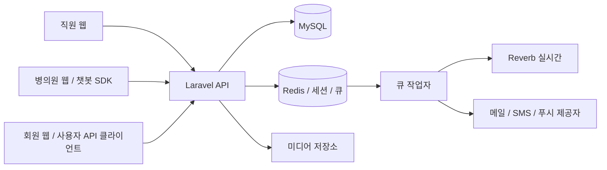

# 시스템 개요

뷰랩은 병의원·의료진·이벤트와 회원 콘텐츠를 관리하고, 상담신청·광고·포인트·운영 상담을 연결하는 시스템입니다.

## 이용 주체

| 주체        | 하는 일                                                | 진입점                                  |
| ----------- | ------------------------------------------------------ | --------------------------------------- |
| 직원        | 검수, 운영 처리, 게시물·신고 관리, 가격·권한·정책 설정 | staff-web, `/api/v1/staff`              |
| 병의원 계정 | 소속 병의원 업무, 비대면 답변, 직원과 챗봇 상담        | hospital-web, `/api/v1/hospital`        |
| 일반회원    | 콘텐츠 조회·작성, 상담신청, 회원 채팅                  | user-web 및 `/api/v1/user`              |
| 뷰티 계정   | 뷰티 도메인의 별도 API                                 | `/api/v1/beauty`; 웹 완성 범위는 제한적 |

직원, 병의원 계정, 일반회원은 서로 다른 인증 주체입니다. 병의원 레코드와 병의원 로그인 계정도 같은 데이터가 아닙니다. 계정 미생성 병의원을 휴면 계정으로 해석하면 안 됩니다.

## 시스템 연결

프론트는 별도 저장소의 Next.js 모노레포입니다. 서버가 권한·소유권·금액·상태 전환을 최종 검증합니다. 화면에서 버튼을 숨기는 것은 서버 인가를 대체하지 않습니다.

## 주요 업무 흐름

1. 입점·병의원·의료진을 등록하고 검수합니다. 계정 생성 초대는 별도 흐름입니다.
2. 이벤트를 등록하고 검수·공개·기간을 관리합니다. 광고 예약과 노출 위치는 이벤트 자체와 구분합니다.
3. 고객 DB에 이벤트 신청·비대면 상담·리얼모델 신청을 관리합니다. 각 신청은 상태와 과금 연결 범위가 다릅니다.
4. 포인트 원장과 단가 설정을 통해 비용을 관리합니다. 잔액만 수정해 거래 내역을 대신하지 않습니다.
5. 후기·토크·평가·동영상과 신고를 관리합니다. 공개 여부와 신고 조치는 서로 다른 상태입니다.
6. 직원에게 권한과 수신 설정에 맞는 인앱 알림을 전달합니다. 메뉴 숫자·행 강조·헤더 알림은 같은 직원의 읽음 상태를 사용합니다.

## 혼동하기 쉬운 용어

| 용어               | 의미                                                           |
| ------------------ | -------------------------------------------------------------- |
| 고객 DB            | 상담신청·문의 데이터. MySQL 자체를 뜻하지 않음                 |
| 검수 상태          | 신청·검수·승인·반려 같은 처리 단계                             |
| 운영 상태          | 병의원 등의 정상 운영·중지·탈퇴 상태                           |
| 공개 여부          | 콘텐츠를 사용자에게 보여 줄지 여부                             |
| 역할               | 직원 권한의 초기 템플릿과 조직상 구분                          |
| 개인 권한          | 초기화된 직원의 실제 인가 기준                                 |
| 앱 메뉴            | 서로 다른 업무 카테고리를 묶는 사용자 탐색 기준                |
| 미확인 알림        | 해당 직원 수신함의 미읽음 항목. 업무가 신청 상태라는 뜻이 아님 |
| 유상·서비스 포인트 | 충전금 지갑의 서로 다른 잔액. 현금 원화와도 구분               |

## 현재 범위와 한계

직원 웹에 대부분의 관리 화면이 연결되어 있습니다. 병의원 웹에는 계정·인증과 챗봇 SDK가 있으며, 사용자 웹은 기본 인증·계정 화면 중심입니다. 사용자 API가 있다는 이유로 소비자 앱 화면까지 완성됐다고 보지 않습니다.

React Native 앱과 독립 뷰티 웹은 현재 저장소에 없습니다. 직원 뷰티 메뉴에는 제목만 표시하는 페이지가 남아 있습니다. 모바일 앱·뷰티의 출시 범위와 운영 인프라 구성은 코드만으로 확정할 수 없습니다.

전체 기능 연결은 [기능 지도](feature-map.md), 업무별 제약은 [문서 목차](README.md)를 따릅니다.
