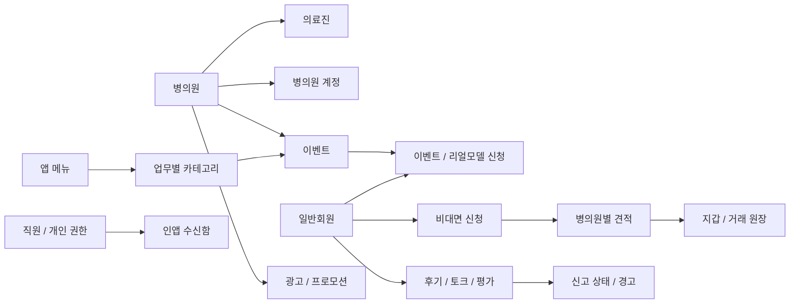

# 백엔드 구조

## 기술 스택과 실행 진입점

PHP 8.3 이상과 Laravel 12를 사용합니다. MySQL 8, Redis, Sanctum, Spatie Permission·Query Builder·Activitylog, Horizon, Reverb, Scramble이 주요 구성입니다. 정확한 의존성은 [composer.json](../../composer.json)과 잠금 파일을 따릅니다.

| 위치                                       | 역할                                 |
| ------------------------------------------ | ------------------------------------ |
| `public/index.php`                         | HTTP 진입                            |
| `bootstrap/app.php`                        | 라우팅, 공통 미들웨어, 예외 변환     |
| `routes/api.php`                           | API 버전·주체별 모듈 연결, 미디어    |
| `app/Modules/{Staff,Hospital,User,Beauty}` | 주체별 라우트·Controller·Request     |
| `app/Domains`                              | 업무 Action·Query·Model·Policy·DTO   |
| `app/Common`                               | 인증·HTTP·예외·미디어 등 기술 기반   |
| `app/Domains/Common`                       | 카테고리·알림·메모·신고 등 공통 업무 |
| `routes/console.php`                       | 명령과 주기 실행                     |
| `database/migrations`                      | 실제 테이블·인덱스·제약 기준         |

## 요청 흐름

```text
주체별 API 라우트
  → 세션/토큰·계정 상태·속도 제한
  → Request 입력 검증
  → Controller 응답 조립
  → Action 업무·인가·트랜잭션
  → Query / Model / 외부 연동
  → DTO / ApiResponse
```

모든 도메인이 동일한 계층 수를 갖지는 않습니다. 현재 일부 Query에는 생성·수정도 있습니다. 이름을 맞추기 위해 일괄 Repository 계층을 추가하지 않습니다. 변경 시 해당 도메인의 실제 책임과 호출 관계를 먼저 봅니다.

## 주요 데이터 경계



이 그림은 개념 관계입니다. 필수 여부·다형 타입·유일성·삭제 규칙까지 표현한 DDL이 아닙니다. 별도의 수동 SQL 스키마를 복제하지 않고 마이그레이션과 Model 관계를 함께 확인합니다.

## 무결성의 책임

- 외래키·유니크 인덱스는 DB, 입력 형식은 Request, 업무 전환·소유권은 Action·Policy가 담당합니다.
- 지갑, 광고 예약, 상태 요청, 직원 권한, 카테고리 이동, 상담 연결은 잠금·조건부 갱신·멱등 키가 중요합니다.
- 미디어·카테고리·메모·히스토리·신고에는 다형 관계가 있습니다. 클래스 문자열을 임의 조합하지 않고 현재 morph map·Registry를 따릅니다.
- 트랜잭션은 DB 상태만 원자적으로 묶습니다. 파일 생성·외부 발송·브로드캐스트를 자동으로 되돌리지 않습니다.
- 평가 집계 등 Model 이벤트에 파생 처리가 있습니다. Query Builder·직접 SQL·withoutEvents 사용 시 우회되는 처리를 확인합니다.

## 공통화 경계

공통화할 수 있는 것은 같은 의미의 응답·미디어 수명·읽음 처리·검증 기반입니다. 이벤트 검수, 의료진 검수, 광고 예약의 필수값과 전환은 각 도메인에 둡니다. 공통 Controller가 모든 업무를 문자열 분기로 처리하게 만들지 않습니다.

뷰티 도메인·Faq 등 잔존 디렉터리를 활성 화면의 완성 증거로 삼지 않습니다. 현재 연결은 [기능 지도](../feature-map.md)가 안내합니다.

## 기준 코드

[bootstrap](../../bootstrap/app.php), [API 라우트](../../routes/api.php), [도메인](../../app/Domains), [모듈](../../app/Modules), [마이그레이션](../../database/migrations), [프로바이더](../../app/Providers).
